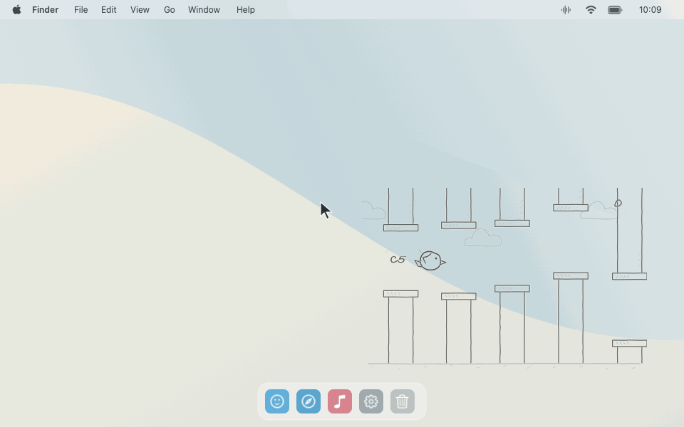
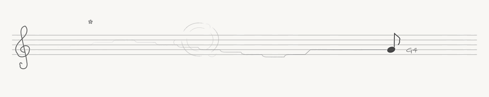

# Miucs · 桌面音乐可视化

**让音乐自己飞。**

一个原生 macOS 桌面音乐可视化工具。可以看小鸟随旋律穿行，也可以让八分音符在长条五线谱上随节奏倾摆、随音量缩放；同时打字，按键对应的位置会炸开一簇五角星。两种模式都使用透明的铅笔线稿。

`macOS 14+` · `Apple Silicon` · `Swift 6` · `AppKit` · `Windows 规划中`



> 空白模拟桌面，展示透明悬浮效果；光标与框选动画用于示意鼠标穿透。飞鸟由合成音频驱动真实分析与绘制代码，未录制真实桌面或播放内容。GIF 无声。

<details>
<summary>查看铅笔线稿特写</summary>


</details>

## 它是什么

菜单栏「可视化」提供两种模式。「铅笔飞鸟」将 Flappy Bird 风格的飞行画面变成音乐的演出，小鸟自动穿过管道并计分；「五线谱音符」以真实谱位表现旋律，保留向左淡出的近期轨迹。

- **旋律即高度**：主旋律越高，小鸟飞得越高；短缓动让升降连续自然。
- **看得见的音符**：鸟后方显示 `C4`、`F♯4` 等音名，数字代表八度；`C4` 是中央 C。
- **会让路的管道**：随机管道提前平滑避让，大跳音时柔和展开开口；从右往左逐渐淡出，到小鸟处消失。
- **会摆动的音符**：符干与符尾绕实心符头左右倾摆，音量起伏带动明显缩放，音高仍落在准确谱位。
- **打字会开花**：五线谱里藏着键盘布局，按键在对应位置散出小星星；与音乐同时生效，静音也能使用。
- **统一铅笔画风**：细铅笔线条、手写数字、稀疏云朵与点状尾迹。
- **五种笔色**：菜单栏直接选择石墨灰、雾蓝、苔绿、赭橙或雾紫，两种模式共用一个选择，即时生效并自动保存。
- **融入桌面**：透明、无边框、默认鼠标穿透，不抢键盘焦点。
- **大小随你**：菜单预设与拖动缩放均可用，两种模式分别保存位置与尺寸，并记住上次选择。
- **声音自动恢复**：休眠唤醒、音频中断或输出设备切换后自动重连；正常静音不会触发重连。
- **减少刷新停顿**：动画对齐屏幕刷新，五线谱复用原生矢量图层与文字缓存；音频设备检查在后台执行。

## 五线谱音符



> 合成音频与预设按键同时经过生产分析、事件通道、动画和原生图层绘制，展示五行键位、多键同按和长按星爆；没有录制真实输入或桌面。纸色背景用于衬托透明线稿；GIF 无声，25fps、10 秒循环，演示帧率不代表应用的屏幕刷新率。

默认 **800 × 160**，音符位于画面宽度的约 80% 处。固定高音谱号和 8 点线距，不随音域拉伸；高低音补加线。`C4` 与 `C♯4` 处于同一谱位，通过升号区分，八度保留真实距离。

| 声音特征 | 五线谱表现 |
| --- | --- |
| 可靠主旋律音高 | 小幅变化立即跟随，较大跳跃经约 20～60ms 连续确认，再平滑升降约 150ms 收稳，旁边显示音名 |
| 起音事件 | 符干与符尾绕实心符头中心左右倾摆，每侧最多 20°，随后逐渐回正；符头、升号和音名保持方向 |
| 音量包络 | 按当前乐段的音量起伏增强大小对比，围绕符头中心平滑缩放约 0.8～1.5 倍，并影响倾摆力度 |
| 最近的可靠音高 | 过滤短时异常，轨迹做 25ms 轻度平滑后向左移动并淡出，保留最多 8 秒、512 点 |
| 缺失旋律 / 静音 | 保持最后谱位，音名淡为 `—`，停止新增轨迹；静音时倾摆回正，缩放回到 0.94 倍 |

音符固定为八分音符造型，不推断时值、调号、拍号或和弦，也不生成完整乐谱。默认石墨灰，支持全局五种笔色。

实心符头中心是倾摆支点，左右位置固定；高低位置由旋律决定。浅色符头与加线标示准确谱位，旋律轨迹不受倾摆或缩放影响。

键盘采用隐形的 ANSI QWERTY 主键区，保留错位行、宽键中心和左右修饰键，按物理键位定位，中文输入法不改变爆点。每次按下是一颗中心星加 6 颗散开的小星，约 650ms 消失；普通键按住 300ms 后每 180ms 补一次较小星爆，松开停止。修饰键只响应按下，Caps Lock 每次切换触发；首版不包含功能键、方向键、导航区和数字小键盘。

星星位于轨迹上方、音符和音名下方，随窗口等比缩放并使用全局笔色。音频未连接或静音时仍可独立响应键盘。布局、生命周期及性能验证见[五线谱说明](docs/staff-note.md)。

## 铅笔飞鸟的特征映射

| 声音特征 | 画面表现 |
| --- | --- |
| 主旋律音高 | 小鸟的目标高度与音名标签 |
| 起音事件 | 振翅时机与羽毛尾迹 |
| 音量包络 | 小鸟体积、翼幅和身体伸展，越响越大 |
| 频谱带宽 | 新管道与鸟的水平距离，频谱越宽，出现时越远 |
| 频谱变化量 | 鸟后冒出铅笔线稿的放屁气团，变化越强越明显 |
| 低频能量 | 管道笔触轻重与管口脉动 |
| 中频能量 | 场景前进速度的小幅变化 |
| 高频能量 | 鸟后方的细点与短线尾迹 |
| 音色明暗与噪声感 | 背景笔触轻重和尾迹分散程度 |
| 静音 | 停止生成管道，场景减速，小鸟收翅悬停 |

音量改变小鸟大小和动作力度，音高决定高度。高度使用按半音排列的音高坐标，音域会根据最近的可靠旋律缓慢适配。没有可靠旋律时，小鸟保持最后高度，音名标签淡出为 `—`。

## 构建与启动

当前构建脚本面向 **Apple Silicon / macOS 14 及以上**。需要支持 Swift 6 的 Xcode 或 Command Line Tools；首次创建本地开发签名时还需要 OpenSSL 3。

在项目目录执行：

```sh
zsh build.sh
open dist/Miucs.app
```

首次运行时，按 macOS 提示授权系统音频捕获。授权恢复后会自动连接；休眠唤醒或采集中断也会自动恢复，菜单栏「重新连接音频」保留为手动入口。

键盘输入通道与音频同时运行。首次启动新增通道时会请求 macOS「输入监控」权限，也可点击菜单「键盘监听」进入授权；菜单显示连接、等待授权或暂停状态。选择「五线谱音符」即可看到键盘星爆，飞鸟保持原有音频映射。按键数据仅在内存中短暂处理，不保存输入文字。详见[键盘输入契约](contracts/keyboard-input/README.md)。

如果音乐正常、打字没有星爆，先查看菜单「键盘监听」是否为“已连接”。开启系统权限后若选择“退出并重新打开”，请确认“应用程序”里的 Miucs 也已更新，避免系统重开旧版本。

### 桌面操作

| 菜单项 / 操作 | 用途 |
| --- | --- |
| 显示拾音器 / 隐藏拾音器 | 控制悬浮画面的显示 |
| 可视化 | 切换「铅笔飞鸟」与「五线谱音符」 |
| 画面大小 | 选择 80%、100%、125%、150%、200% 缩放 |
| 线条颜色 | 在五种笔色中直接点选，所有可视化共用 |
| 调整位置与大小… | 暂时接收鼠标，拖动画面移动，拖动右下角缩放 |
| 完成调整 | 保存位置和大小，恢复鼠标穿透 |
| 重新连接音频 | 重新建立系统音频捕获 |
| 键盘监听 | 查看监听状态，未授权时点击打开输入监控权限 |

### 选择笔色

从菜单栏打开「线条颜色」，点选即可。当前颜色带有勾选标记和色点，整幅画面使用同一支笔；原有线条轻重、透明度和浅色衬线继续保留。

| 笔色 | 色值 |
| --- | --- |
| 石墨灰 | `#3D3D3D` |
| 雾蓝 | `#4F7087` |
| 苔绿 | `#56705B` |
| 赭橙 | `#BF704B` |
| 雾紫 | `#8B72A2` |

切换模式、隐藏显示或重启后仍沿用所选颜色。升级时，旧飞鸟配色按小鸟主色映射到最近的笔色，原配色数据保留。颜色切换只更新绘制，不重连音频、不清空旋律轨迹。

飞鸟默认大小为 400 × 260，五线谱默认 800 × 160；缩放保持各自比例，并限制在当前屏幕范围内。五线谱宽度范围为 600～1600 点，屏幕较小时进一步缩小。

## 本地声音处理

运行时使用 ScreenCaptureKit 获取系统音频，在本机完成特征分析和绘制，无需网络服务、外部模型或 Python。应用不保存真实音频或屏幕画面。

主旋律采用本地谐波显著性近似估计。复杂伴奏可能被误选为主线，音名标签应作为可视化参考；静音或无法确认音高时不会编造音符。

## 开发与验证

```sh
zsh scripts/test-contracts.sh
zsh scripts/test-melody.sh
zsh scripts/test-flight.sh
zsh scripts/test-staff-note.sh
zsh scripts/test-staff-note-platform.sh
zsh scripts/test-keyboard.sh
zsh scripts/test-staff-keyboard.sh
zsh scripts/test-palette.sh
zsh scripts/test-appearance.sh
zsh scripts/test-audio-recovery.sh
zsh scripts/test-visualization-host.sh
zsh scripts/validate-audio.sh
```

性能测量（使用合成场景）：

```sh
zsh scripts/measure-performance.sh
zsh scripts/measure-performance.sh --cadence
zsh scripts/measure-performance.sh --staff-cadence
# 指定窗口宽度（点）和测量时长（秒）
zsh scripts/measure-performance.sh --staff-cadence build/staff-cadence.json 640 15
# 每秒 20 次按键 / 满 112 颗星的 CPU 更新与图层提交
zsh scripts/measure-performance.sh --staff-keyboard build/staff-keyboard-performance.json
# 音频 + 键盘同时运行时的真实窗口刷新间隔
zsh scripts/measure-performance.sh --staff-keyboard-cadence build/staff-keyboard-cadence.json 800 15
```

带 `--cadence`、`--staff-cadence` 或 `--staff-keyboard-cadence` 的命令会短暂显示相应测试窗口，测量真实刷新间隔；不采集系统声音、桌面画面，也不向系统注入按键。键盘星爆的自动验证与性能数据见[验证记录](docs/validation/staff-keyboard-validation.json)。

最近一次 640 点窗口的 15 秒对照测量中，优化后平均约 60fps，最长刷新间隔从 61ms 降至 30ms，仍有零星 25～30ms 波动。测试方法、各阶段数据和限制见 [五线谱刷新记录](docs/validation/staff-render-performance.json)。

重新生成 README 中的五线谱演示：

```sh
zsh scripts/render-demo.sh --staff
```

导出使用生成的音频、预设物理按键和生产绘制代码，输出 `docs/assets/miucs-staff-note.gif`，无需播放声音或录制屏幕。帧数、动作范围和编码检查见 [演示验证记录](docs/validation/staff-demo.json)。

独立数值参考与契约验证使用 Python 开发依赖，可通过 `python3 -m pip install -r tests/requirements.txt` 安装；应用运行不依赖 Python。

### 项目结构

```text
contracts/                 音频、键盘与可视化契约，音频 Schema 和合成样本
modules/audio/             通用分析与实时通道，及各平台采集和数值后端
modules/keyboard/          键盘事件、状态通道与 macOS 全局监听
modules/visualizations/    通用模块接口、飞鸟 / 五线谱场景及各平台绘制
apps/                      各平台应用入口、窗口和菜单
tests/                     契约、音频、场景和平台验证
tools/                     离线演示、诊断与性能工具
scripts/                   保持原有构建与验证命令入口
docs/                      架构、设计说明、验证记录与演示资源
```

音频与键盘通过各自的进程内实时通道同时送达可视化；连续状态取最新快照，短事件有界保留。可视化模块通过注册接入，一次显示一种，切换不重启两个输入源。Windows 目前仅预留职责说明、接口和合成测试样本，不提供可运行版本，也未指定实现语言。

- [开发、测试与新增模块](CONTRIBUTING.md)
- [分层架构与依赖边界](docs/architecture.md)
- [音频数据契约](contracts/audio-features/README.md)
- [键盘输入与并行通道](contracts/keyboard-input/README.md)
- [画风、特征映射与验证结果](docs/sound-flight.md)
- [五线谱音符的谱位、运动与验证](docs/staff-note.md)
- [全局笔色与模块接入](docs/appearance.md)
- [音频特征定义与提取方法](docs/audio-features.md)
