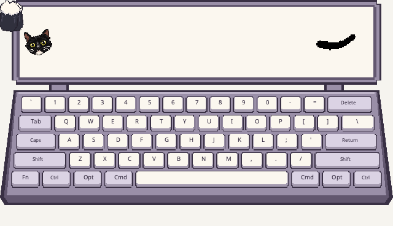

# Miucs · 奶牛猫桌面伙伴

**打字时伸爪，听音乐时摇尾。**

奶牛猫是 Miucs 的默认桌面伙伴：黑白猫爪跟随按键，猫头随打字轻晃，尾巴响应音乐节拍。画面透明、默认鼠标穿透，不抢键盘焦点。

`macOS 14+ · Apple Silicon · Swift 6` · `Windows 10/11 · 实机待验`



> 预览使用合成音乐与按键输入，经正式 Lua/Skia 绘制器生成；GIF 无声，不是桌面录屏。

## 七个桌面伙伴

| 插件 | 效果 | 详细说明 |
| --- | --- | --- |
| **奶牛猫 · 默认主打** | 黑白猫爪敲键、猫头轻晃、尾巴随节拍摆动 | [奶牛猫](docs/pixel-keyboard.md) |
| 麦芬 | 两只线条小狗随打字跳跃，麦芬随节拍吹泡泡 | [麦芬](plugins/muffin-puppies/README.md) |
| 牛来 | 牛蹄响应按键，上方角色随音乐和打字运动 | [牛来](plugins/niulai-keyboard/README.md) |
| 平次与和叶 | 平次随打字挥木剑，和叶随节拍转身 | [平次与和叶](plugins/heiji-kazuha/README.md) |
| 塞尔达 | 林克随按键挥剑、举盾，守护者随拍点发射激光 | [塞尔达](plugins/zelda-guardian/README.md) |
| 摇曳露营 | 抚子随打字吃面，凛随音乐捧杯轻啜，篝火随拍点轻跳 | [摇曳露营](plugins/yuru-camp/README.md) |
| 犬夜叉 | 打字时犬夜叉逞强，节拍触发戈薇指地、扑地和七宝受惊，全程无对白 | [犬夜叉](plugins/inuyasha/README.md) |

[查看七个插件的动态预览](docs/plugin-previews.md)。首次启动默认选择奶牛猫；之后记住你的选择。所有皮肤共用当前位置和大小，切换只换画面，重启恢复同一位置；不重启输入采集。

## 构建与启动

### macOS

需要 Apple Silicon、macOS 14+、Swift 6、Python 3.10+、CMake 3.24+；首次本地开发签名需要 OpenSSL 3。

```sh
zsh build.sh
open dist/Miucs.app
```

首次运行按提示授权系统音频捕获；要让猫爪响应打字，授予「输入监控」权限。音频和键盘可以同时使用，也能独立运行。系统休眠或音频中断后自动恢复，也可在「设置 → 声音与键盘」重新连接音频。更新后先退出旧版，再打开新构建。

### Windows

提供 .NET 8/WPF、WASAPI 实现。构建方法见 [Windows README](apps/windows/README.md)，实机验证范围见 [验收表](docs/windows-acceptance.md)。

## 设置与常用操作

macOS 和 Windows 都有独立设置窗口，分为「皮肤」「外观与位置」「声音与键盘」「关于 Miucs」。皮肤卡片直接显示图片或 GIF；整张卡片和整行侧栏都可点击，并有悬浮与按下反馈。五线谱与铅笔飞鸟不再提供。

- **皮肤**：卡片选择、打开皮肤目录、重新扫描、重新加载当前皮肤。
- **外观与位置**：调整大小、不透明度和桌面位置；切换皮肤保持当前矩形。
- **声音与键盘**：查看连接状态、重新连接；Windows 键盘响应需主动启用，托盘动画开关也在这里。
- **桌面调整**：鼠标悬停 3 秒点击小锁，再拖动或从右下角缩放，完成后恢复鼠标穿透。

macOS 在程序坞显示 Miucs，点击打开设置；Windows 设置显示在任务栏，关闭时最小化并继续运行，点击任务栏或再次运行应用可恢复设置。菜单栏 / 托盘仅保留打开设置、显示 / 隐藏皮肤、调整位置与大小和退出。

## 插件与隐私

应用内置七个 Lua 5.4/Skia 插件，也可安装自己编写的插件。首次构建自动下载并校验运行库依赖。开发和调试见 [插件开发指南](docs/plugin-development.md) 与 [插件工作台](docs/plugin-lab.md)。

音频与物理按键只在本机分析，不依赖网络模型；应用不保存真实音频、屏幕或输入文字。

## 开发文档

- [贡献指南与测试](CONTRIBUTING.md) · [架构与依赖边界](docs/architecture.md)
- [插件契约](contracts/plugins/README.md) · [可视化契约](contracts/visualization/README.md)
- [音频数据](contracts/audio-features/README.md) · [键盘数据](contracts/keyboard-input/README.md)
- [外观设置](docs/appearance.md) · [验证记录](docs/validation/README.md)
