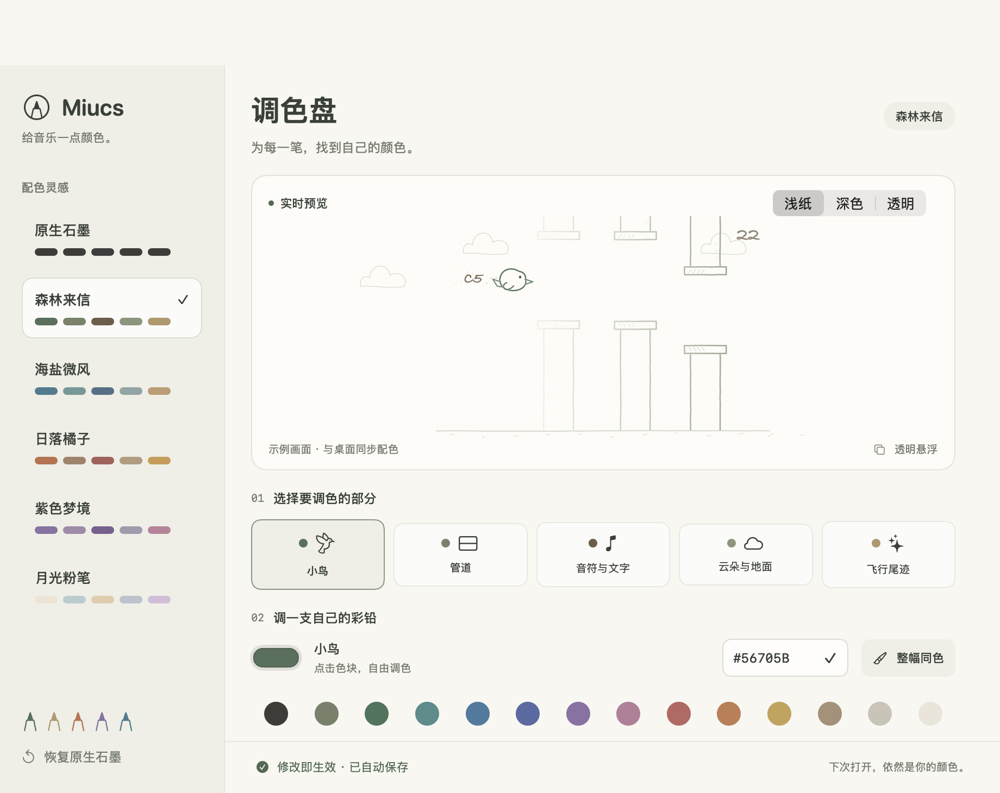

# Miucs · Pencil Flight

**让音乐自己飞。**

一个原生 macOS 桌面音乐可视化工具：把正在播放的声音，变成一只在铅笔线稿世界里自动飞行的小鸟。旋律决定高度，节奏带来振翅，管道在靠近时轻轻让开。

`macOS 14+` · `Apple Silicon` · `Swift 6` · `AppKit` · `Windows 规划中`


> 空白模拟桌面，展示透明悬浮效果；光标与框选动画用于示意鼠标穿透。飞鸟由合成音频驱动真实分析与绘制代码，未录制真实桌面或播放内容。GIF 无声。

<details>
<summary>查看铅笔线稿特写</summary>


</details>

## 它是什么

Miucs 将 Flappy Bird 风格的飞行画面变成音乐的演出。播放音乐即可观看，小鸟会自动穿过管道，每次通过都会计分，无需点击或操控。

- **旋律即高度**：主旋律越高，小鸟飞得越高；短缓动让升降连续自然。
- **看得见的音符**：鸟后方显示 `C4`、`F♯4` 等音名，数字代表八度；`C4` 是中央 C。
- **会让路的管道**：随机管道提前平滑避让，大跳音时柔和展开开口；从右往左逐渐淡出，到小鸟处消失。
- **统一铅笔画风**：石墨灰线条、手写数字、稀疏云朵与点状尾迹。
- **自定义彩铅**：调色盘提供六套配色，可独立调整小鸟、管道、音符与文字、云朵与地面、飞行尾迹，实时生效并自动保存。
- **融入桌面**：透明、无边框、默认鼠标穿透，不抢键盘焦点。
- **大小随你**：菜单预设与拖动缩放均可用，移动后即保存位置，退出时补存位置和尺寸，重新打开自动恢复。
- **声音自动恢复**：休眠唤醒、音频中断或输出设备切换后自动重连；正常静音不会触发重连。
- **平稳刷新**：动画对齐屏幕刷新，复用笔迹与文字排版；放大画面时只合成管道附近的渐隐区域。

## 音乐如何变成画面

| 声音特征 | 画面表现 |
| --- | --- |
| 主旋律音高 | 小鸟的目标高度与音名标签 |
| 起音事件 | 振翅时机与羽毛尾迹 |
| 音量包络 | 小鸟体积、翼幅和身体伸展，越响越大 |
| 频谱带宽 | 新管道与鸟的水平距离，频谱越宽，出现时越远 |
| 频谱变化量 | 鸟后冒出铅笔线稿的放屁气团，变化越强越明显 |
| 低频能量 | 管道笔触轻重与管口脉动 |
| 中频能量 | 场景前进速度的小幅变化 |
| 高频能量 | 鸟后方的细点与短线尾迹 |
| 音色明暗与噪声感 | 背景笔触轻重和尾迹分散程度 |
| 静音 | 停止生成管道，场景减速，小鸟收翅悬停 |

音量改变小鸟大小和动作力度，音高决定高度。高度使用按半音排列的音高坐标，音域会根据最近的可靠旋律缓慢适配。没有可靠旋律时，小鸟保持最后高度，音名标签淡出为 `—`。

## 构建与启动

当前构建脚本面向 **Apple Silicon / macOS 14 及以上**。需要支持 Swift 6 的 Xcode 或 Command Line Tools；首次创建本地开发签名时还需要 OpenSSL 3。

在项目目录执行：

```sh
zsh build.sh
open dist/Miucs.app
```

首次运行时，按 macOS 提示授权系统音频捕获。授权恢复后会自动连接；休眠唤醒或采集中断也会自动恢复，菜单栏「重新连接音频」保留为手动入口。

### 桌面操作

| 菜单项 / 操作 | 用途 |
| --- | --- |
| 显示拾音器 / 隐藏拾音器 | 控制悬浮画面的显示 |
| 可视化 | 选择已注册的内置模块，当前提供铅笔飞鸟 |
| 画面大小 | 选择 80%、100%、125%、150%、200% 缩放 |
| 调色盘… | 选择配色预设、独立调色或一键整幅同色 |
| 调整位置与大小… | 暂时接收鼠标，拖动画面移动，拖动右下角缩放 |
| 完成调整 | 保存位置和大小，恢复鼠标穿透 |
| 重新连接音频 | 重新建立系统音频捕获 |

### 铅笔画调色

从菜单栏打开「调色盘…」，先选择要修改的部分，再点击颜色块打开系统调色盘，或输入 HEX 色值并按回车。底部色卡可快速选色，「整幅同色」将当前颜色用于全部笔触；「恢复原生石墨」恢复初始颜色。

预览支持浅纸、深色和透明棋盘背景，背景切换仅用于检查配色。配色同步到桌面画面，关闭窗口或重启应用后仍然保留。调色盘使用示例场景，没有播放音乐时也能预览。



默认大小为 400 × 260；连续缩放保持原始比例，并限制在当前屏幕范围内。

## 本地声音处理

运行时使用 ScreenCaptureKit 获取系统音频，在本机完成特征分析和绘制，无需网络服务、外部模型或 Python。应用不保存真实音频或屏幕画面。

主旋律采用本地谐波显著性近似估计。复杂伴奏可能被误选为主线，音名标签应作为可视化参考；静音或无法确认音高时不会编造音符。

## 开发与验证

```sh
zsh scripts/test-contracts.sh
zsh scripts/test-melody.sh
zsh scripts/test-flight.sh
zsh scripts/test-palette.sh
zsh scripts/test-audio-recovery.sh
zsh scripts/test-visualization-host.sh
zsh scripts/validate-audio.sh
```

性能测量（使用合成场景）：

```sh
zsh scripts/measure-performance.sh
zsh scripts/measure-performance.sh --cadence
```

第二条命令会短暂显示测试窗口，测量真实刷新间隔；不采集系统声音或桌面画面。

独立数值参考与契约验证使用 Python 开发依赖，可通过 `python3 -m pip install -r tests/requirements.txt` 安装；应用运行不依赖 Python。

### 项目结构

```text
contracts/                 语言无关的音频与可视化契约、Schema 和合成样本
modules/audio/             通用分析与实时通道，及各平台采集和数值后端
modules/visualizations/    通用模块接口、飞鸟场景及各平台绘制
apps/                      各平台应用入口、窗口和菜单
tests/                     契约、音频、场景和平台验证
tools/                     离线演示、诊断与性能工具
scripts/                   保持原有构建与验证命令入口
docs/                      架构、设计说明、验证记录与演示资源
```

音频生产与绘制消费通过进程内实时通道连接；连续状态取最新快照，短起音与频谱变化峰值单独保留。可视化模块通过注册接入，一次显示一种，切换不重启音频。Windows 目前仅预留职责说明、接口和合成测试样本，不提供可运行版本，也未指定实现语言。

- [开发、测试与新增模块](CONTRIBUTING.md)
- [分层架构与依赖边界](docs/architecture.md)
- [音频数据契约](contracts/audio-features/README.md)
- [画风、特征映射与验证结果](docs/sound-flight.md)
- [音频特征定义与提取方法](docs/audio-features.md)
