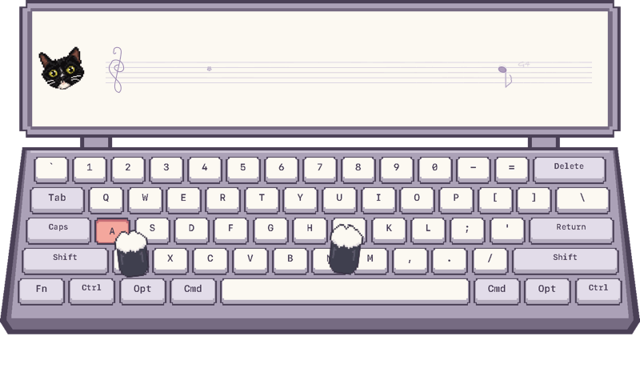

# Miucs · 桌面音乐可视化

**让音乐自己飞。**

把音乐和打字变成桌面上的动画：随旋律飞行的小鸟、随节奏摆动的音符，以及跟着按键敲击的像素猫。画面透明、默认鼠标穿透，不抢键盘焦点。

`macOS 14+ · Apple Silicon · Swift 6` · `Windows 10/11 · 实机待验`



> 合成输入驱动原生绘制器生成的演示，未录制真实输入或桌面；GIF 无声。

## 三种可视化

| 模式 | 效果 | 详细说明 |
| --- | --- | --- |
| 像素音乐键盘 | 猫爪敲击真实物理键位，猫头随打字速度摇动，尾巴响应音乐节拍 | [像素键盘](docs/pixel-keyboard.md) |
| 五线谱音符 | 主旋律驱动音符与轨迹，节拍展开轻弧，按键散出星星 | [五线谱](docs/staff-note.md) |
| 铅笔飞鸟 | 音高决定飞行高度，音量与起音带动振翅，管道自动避让 | [飞鸟](docs/sound-flight.md) |

音频和键盘可以同时驱动画面，也能独立使用。每种模式分别记住位置和大小，切换时不重启输入采集。仅使用 Lua/Skia 插件，也可以添加自己编写的 Lua 可视化。

## 构建与启动

### macOS

需要 Apple Silicon、macOS 14+、支持 Swift 6 的 Xcode 或 Command Line Tools、Python 3.10+ 和 CMake 3.24+；首次创建本地开发签名需要 OpenSSL 3。在仓库根目录执行：

```sh
zsh build.sh
open dist/Miucs.app
```

首次运行按提示授权系统音频捕获；需要打字效果时，授予「输入监控」权限。菜单中的「键盘监听」可查看状态。休眠唤醒或音频中断后会自动重连，也可手动选择「重新连接音频」。

### Windows

已有 .NET 8/WPF、WASAPI 实现，实机采集、绘制及多屏验收尚未完成。构建步骤见 [Windows README](apps/windows/README.md)，支持边界见 [验收表](docs/windows-acceptance.md)。

## 常用操作

从菜单栏或托盘打开菜单：

| 操作 | 用途 |
| --- | --- |
| 可视化 | 切换当前画面 |
| 显示 / 隐藏拾音器 | 控制悬浮画面的显示 |
| 画面大小 | 调整缩放比例 |
| 线条颜色 | 选择五种笔色；像素键盘保留固定配色 |
| 画面不透明度 | 10%～100%，即时生效并自动保存 |
| 调整位置与大小… | 拖动画面移动、拖动右下角缩放，完成后恢复鼠标穿透 |

也可以将鼠标停留在画面上 3 秒，点击出现的小锁来解锁或锁定。菜单栏猫图标属于应用本身，不随可视化插件切换。

## 自己制作插件

插件使用 **Lua 5.4 + Skia**，一个文件夹对应一个可视化。复制模板后，编写场景与动画，放入用户插件目录即可加载，无需重新编译应用。

所有构建均包含插件运行库和内置插件。首次构建会下载并校验 Lua、JSON 库和 Skia 依赖：

```sh
zsh build.sh
open dist/Miucs.app
```

更新后请先退出已运行的 Miucs，再打开新版本。应用只支持插件可视化；运行库缺失时会显示错误。

**[插件开发指南 →](docs/plugin-development.md)**：包含完整示例、双端安装步骤、输入数据、热重载、验证预览和常见问题。

## 本地处理

系统音频在本机分析，不依赖网络服务或外部模型；应用不保存真实音频、屏幕画面或输入文字。键盘效果使用物理键位，不受输入法影响。

主旋律是对混音中突出音高的近似估计，复杂伴奏可能影响结果；音符用于可视化，不生成完整乐谱。算法与限制见[混音主旋律说明](docs/predominant-mixture.md)。

## 开发文档

- [贡献指南与测试命令](CONTRIBUTING.md)
- [插件开发指南](docs/plugin-development.md) · [插件 API 契约](contracts/plugins/README.md)
- [架构与依赖边界](docs/architecture.md)
- [音频数据](contracts/audio-features/README.md) · [键盘数据](contracts/keyboard-input/README.md)
- [外观设置](docs/appearance.md) · [验证记录](docs/validation/README.md)

插件版另带 **「牛来」**，详见[牛来说明](plugins/niulai-keyboard/README.md)。
