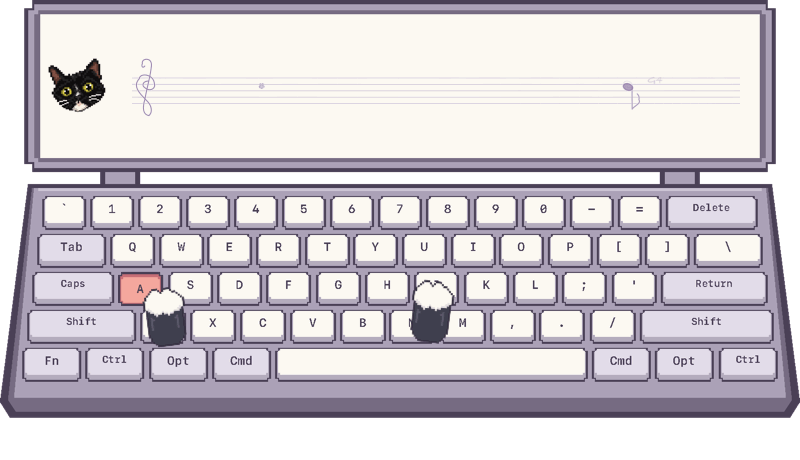

# Miucs · 桌面音乐皮肤

**让音乐自己飞。**

用声音与按键驱动桌面皮肤。画面透明、默认鼠标穿透，不抢键盘焦点。

`macOS 14+ · Apple Silicon · Swift 6` · `Windows 10/11 · 原有实现，实机待验`



> 合成输入驱动的演示，未录制真实输入或桌面；GIF 无声。

## 皮肤与设置（macOS）

一个插件就是一个皮肤，统一在「设置 → 皮肤」中选择。卡片直接展示包内图片或 GIF；选择后才运行该皮肤。当前自带「像素音乐键盘」。五线谱与铅笔飞鸟已退出 macOS 产品选择和打包范围，旧选择会回退到可用皮肤。

设置窗口分为：

- **皮肤**：预览与选择、打开皮肤文件夹、重新扫描、重新加载当前皮肤。
- **外观与位置**：大小、不透明度、桌面拖动与缩放。所有皮肤共用当前位置与大小，切换只更换画面。
- **声音与键盘**：连接状态、输入监控授权、音频与键盘重连。
- **关于 Miucs**：应用信息。

Miucs 同时显示在程序坞和菜单栏中。启动或点击程序坞图标会打开设置；关闭设置窗口后，皮肤和菜单栏继续运行，再次点击图标即可打开设置。菜单栏保留「打开设置」「显示 / 隐藏皮肤」「调整位置与大小」「退出」。也可按 `⌘ ,` 打开设置，或将鼠标停留在皮肤上 3 秒，通过小锁解锁调整。

## 构建与启动

### macOS

需要 Apple Silicon、macOS 14+、Swift 6、C++ 工具链、Python 3.10+ 和 CMake 3.24+；首次开发签名需要 OpenSSL 3。构建默认包含 Lua / Skia 皮肤运行库，首次会下载并校验依赖。

```sh
zsh build.sh
open dist/Miucs.app --args --settings
```

普通启动也会加载皮肤，无需 `--plugins`。首次按提示授权系统音频；打字效果需要「输入监控」权限。休眠唤醒或音频中断后自动重连，也可在设置中手动重连。

### Windows

现有 .NET 8 / WPF / WASAPI 实现保留原有界面；本次独立设置与皮肤入口更新针对 macOS。Windows 构建步骤见 [Windows README](apps/windows/README.md)，实机支持边界见[验收表](docs/windows-acceptance.md)。

## 添加自己的皮肤

皮肤使用 **Lua 5.4 + Skia**，一个文件夹对应一个皮肤。将包放入用户插件目录，在设置中点击「重新扫描」即可，无需重新编译应用。包内可提供 `preview.gif` 或 `preview.png` 作为卡片预览；无预览时显示占位图。

**[皮肤插件开发指南 →](docs/plugin-development.md)**：模板、安装、输入数据、重载、验证与常见问题。

## 本地处理

系统音频在本机分析，不依赖网络服务或外部模型；应用不保存真实音频、屏幕画面或输入文字。键盘效果使用物理键位，不受输入法影响。

## 开发文档

- [贡献指南与测试命令](CONTRIBUTING.md)
- [插件 API 契约](contracts/plugins/README.md)
- [架构与依赖边界](docs/architecture.md)
- [音频数据](contracts/audio-features/README.md) · [键盘数据](contracts/keyboard-input/README.md)
- [验证记录](docs/validation/README.md)
