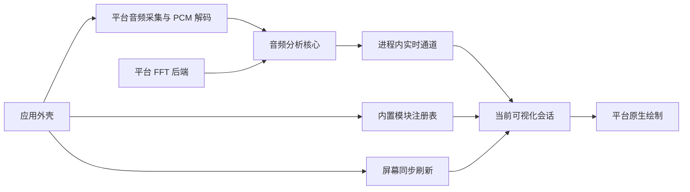

# 音频与可视化分层

Miucs 的两个业务部分是音频特征生产和可视化消费。平台适配负责系统采集、数值后端、原生绘制；应用外壳把它们组合起来。当前运行平台是 macOS，Windows 只有协作入口与验收说明。

## 目录与依赖

| 目录 | 职责与允许依赖 |
| --- | --- |
| `contracts/` | 语言无关的字段、单位、时间语义、版本、Schema 与合成样本 |
| `modules/audio/core/` | PCM 数据模型、分析算法、FFT 后端接口和实时通道；只用 Foundation |
| `modules/audio/platforms/macos/` | ScreenCaptureKit、CoreMedia 解码、恢复、Accelerate FFT；依赖音频核心 |
| `modules/visualizations/api/` | 模块描述、会话、视口、注册和消费调度；只依赖音频数据与通道 |
| `modules/visualizations/api/platforms/macos/` | 原生扩展协议，提供视图与设置入口 |
| `modules/visualizations/pencil-flight/core/` | 特征映射、运动、管道、粒子、纯颜色数据和示例场景 |
| `modules/visualizations/pencil-flight/platforms/macos/` | AppKit 绘图、颜色转换与 SwiftUI 调色盘 |
| `apps/macos/` | 入口、菜单、透明窗口、显示刷新、位置偏好、模块组合注册 |
| `tools/macos/` | 数值诊断、文件分析、离线示例导出和性能测量 |
| `tests/` | 契约、通用音频、场景规则与各平台集成验证 |

通用 API 不出现原生视图、颜色或 Combine 类型；原生扩展单独归入 `platforms/`。音频核心不引用任何飞鸟或窗口对象。macOS 与 Windows 平台实现互不引用。`scripts/check-boundaries.py` 检查当前 Swift 源码的这些约束，`test-contracts.sh` 和 `test-flight.sh` 不链接 Apple UI、采集或 Accelerate 框架。

这些目录是源码与依赖边界，目前仍由 `swiftc` 分组编译成同一个 macOS 应用；不声称已有跨语言二进制 SDK、动态插件加载或 Windows 编译产物。Windows 选择其他语言时，以契约和数值样本验证互操作与等价性。

## 音频生产与数值后端

`AudioPCMBlock` 是平台无关的 Float32 声道数组。原生解码将 `CMSampleBuffer` 转换为此输入；系统权限、休眠/设备变化、重连与退避留在 macOS 适配。

`AudioAnalysisPipeline` 在通用目录编排两个分析器，保留原有窗口、步长、Float32 缓冲、FFT 输出与归一化流程，通过注入 `SpectrumTransform` 执行变换。macOS 使用原有 `vDSP_DFT_Execute`；通用目录没有 Accelerate 调用。Windows FFT 后端明确未实现。格式变化时清理上一格式的旋律缓存，等待新的完整旋律窗口。

采集队列串行运行基础特征与旋律分析，直接写入 `FeatureChannel`。生命周期错误才切回主线程；每个特征帧不再创建主线程任务或发布 Combine 数据。可视化只拿到只读 `AudioFeatureSource`，没有启动或停止采集的接口。

## 实时通道与时序

通道用短锁保护内存值，不执行回调或 UI 工作，不逐帧序列化。连续状态只有一个最新快照；起音保留最多 64 个，超过 250ms 或容量时丢弃最旧项；频谱变化用单调最大值队列保存最近 250ms 的未读区间峰值。订阅者有独立游标，互不排空彼此的事件。

消费者每次屏幕刷新读一次。帧通过 `sessionID + sequence` 去重；同一帧不会反复重置动作。短事件即使下一帧已恢复平静，也能在后续刷新触发。多起音在飞鸟会话中合为一次振翅；其他模块可自行逐个处理。切换或恢复显示时新建订阅，从当前序号开始，不补播先前动作。

每次采集重建产生新 UUID，同时清理快照和事件。旧队列的迟到回调因代次不符被拒绝；消费者收到新代次后清除自己的输入历史。音频窗口中心时间用于音高和测量时间线，主机单调接收时间用于事件过期、帧龄和恢复看门狗，二者不混算。

普通显示不保存帧历史；诊断显式打开独立记录抽头，最多 10,000 帧，读取最新快照不会丢掉诊断帧。诊断仅保存特征数值，不保存实际采集 PCM 或屏幕内容。

## 可视化与应用外壳

`VisualizationRegistry` 保存稳定 ID、名称与创建新会话的工厂。`VisualizationController` 仅管理当前会话、订阅和视口，切换时停用并释放旧会话，再用新订阅激活新会话。它不持有 `AudioEngine`，因此切换不会中断音频。

`PencilFlightSimulation` 是通用飞鸟会话，`SoundFlightWorld` 管理场景规则。原生 `MacPencilFlightSession` 组合通用会话、`PencilFlightView` 和调色盘；绘制对象不再订阅音频、持有计时器或管理窗口。

`VisualizationHostView` 管理屏幕同步刷新、当前原生视图和通用状态提示，以及拖动/缩放交互。`VisualizerPanel` 保留透明、鼠标穿透和位置保存。隐藏窗口停止刷新而音频继续；切换会话关闭旧模块设置界面并取消其订阅。新增内置模块只需实现会话与平台适配，再在 `BuiltInVisualizations` 注册，无须修改音频分析。

兼容项保持 `com.miucs.app`、`Miucs Dev` 签名策略、`MiucsPencilFlight` 窗口保存名、`MiucsPencilFlightFrame` / `MiucsPencilFlightWidth` 以及原配色偏好。现有带宽距离、响度体积和气团效果均属于飞鸟核心。

## 验证入口

运行步骤见 [CONTRIBUTING.md](../CONTRIBUTING.md)。重点证据包括通道积压/峰值/事件过期、并发读写、重连隔离、模块切换与原生视图释放，以及原有数值、旋律、恢复、飞行、窗口、配色测试。合成导出器与性能工具继续调用生产绘制路径，公开资源不包含真实桌面或声音。

本次回归、数值对照、原生刷新、真实采集与恢复、重启及偏好恢复结果见 [分层验收汇总](validation/architecture-validation.json)。桌面解锁后，全部待验项目已完成。
