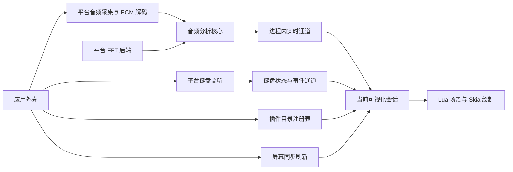

# 输入与可视化分层

Miucs 的输入侧包含并行的音频特征生产与键盘事件生产，可视化在同一帧消费两路数据。平台适配负责系统采集、数值后端和插件画面展示；应用外壳把它们组合起来。macOS 为已实测平台；Windows 新增独立 .NET 8/WPF、WASAPI 与物理键监听实现，Linux 核心测试及交叉构建已验证，Windows 实机验收待完成。

音高路径将原始混音直接送入 `MelodyAnalyzer`：频谱峰插值、有界局部白化、谐波显著度、音调性/支持度可靠性判断与相邻候选连续性。`AudioAnalysisPipeline` 将同一 PCM 直接交给主旋律和特征分析器，格式改变时重置音高历史；没有来源切换、模型推理或分离延迟补偿。`StreamOutput` 在后台准备 FFT 状态，实时音频队列只推进原生分析。旧的来源偏好不再读取。

## 目录与依赖

| 目录 | 职责与允许依赖 |
| --- | --- |
| `contracts/` | 语言无关的字段、单位、时间语义、版本、Schema 与合成样本 |
| `modules/audio/core/` | PCM 数据模型、分析算法、FFT 后端接口和实时通道；只用 Foundation |
| `modules/audio/platforms/macos/` | ScreenCaptureKit、CoreMedia 解码、恢复、Accelerate FFT；依赖音频核心 |
| `modules/keyboard/core/` | 按键值类型、修饰状态、按住时长、敲击频率和独立订阅；只用 Foundation |
| `modules/keyboard/platforms/macos/` | 只读 CGEventTap、输入监控权限、安全输入及休眠恢复；依赖键盘核心 |
| `modules/visualizations/api/` | 模块描述、会话、视口、通用 RGB 笔色、注册和消费调度；只用 Foundation |
| `modules/visualizations/api/platforms/macos/` | 原生扩展协议、公共笔色到 AppKit 的转换 |
| `plugins/` | Lua 场景、动画和插件资源 |
| `modules/plugins/` | 隔离 worker、输入传输、Skia 与平台展示 |
| `apps/macos/` | 入口、菜单、透明窗口、显示刷新、位置偏好、模块组合注册 |
| `tools/macos/` | 输入诊断与音频文件分析 |
| `tests/` | 契约、通用音频、场景规则与各平台集成验证 |

通用 API 不出现原生视图、颜色或 Combine 类型；原生扩展单独归入 `platforms/`。音频核心不引用任何飞鸟或窗口对象。macOS 与 Windows 平台实现互不引用。`scripts/check-boundaries.py` 检查当前 Swift 源码的这些约束，`test-contracts.sh` 不链接 Apple UI、采集或 Accelerate 框架。

这些目录是源码与依赖边界：macOS 由 `swiftc` 分组编译；Windows 由 `apps/windows/Miucs.Windows.csproj` 组合各 Windows 目录的 C# 源码。Lua 插件通过 C ABI 宿主桥接到隔离 worker，不加载第三方原生插件。Windows 的数值、事件、场景和窗口偏好在独立可移植测试中验证，原生平台检查见 `docs/windows-acceptance.md`。

## 音频生产与数值后端

`AudioPCMBlock` 是平台无关的 Float32 声道数组。原生解码将 `CMSampleBuffer` 转换为此输入；系统权限、休眠/设备变化、重连与退避留在 macOS 适配。

`AudioAnalysisPipeline` 在通用目录编排两个分析器，保留原有窗口、步长、Float32 缓冲、FFT 输出与归一化流程，通过注入 `SpectrumTransform` 执行变换。macOS 使用原有 `vDSP_DFT_Execute`；通用目录没有 Accelerate 调用。Windows 在 `modules/audio/platforms/windows/Core/` 提供独立 C# FFT/分析移植，以公共契约和合成数值验证，不直接加载 Swift 二进制。格式变化时清理上一格式的旋律缓存，等待新的完整旋律窗口。

`AudioFeatureAnalyzer` 内的 `BeatTracker` 复用混音频谱变化与低频能量，输出独立节拍状态，不依赖人声分离/音高模型。

采集队列串行运行基础特征与旋律分析，直接写入 `FeatureChannel`。生命周期错误才切回主线程；每个特征帧不再创建主线程任务或发布 Combine 数据。可视化只拿到只读 `AudioFeatureSource`，没有启动或停止采集的接口。

恢复看门狗通过最近 PCM 的接收时间先判断健康，新数据持续到达时跳过设备探测。必要的 Core Audio 输出设备查询在后台执行，返回后重新检查采集代次、运行和取消状态；主线程只处理恢复决策。

## 实时通道与时序

通道用短锁保护内存值，不执行回调或 UI 工作，不逐帧序列化。连续状态只有一个最新快照；起音和节拍各保留最多 64 个，超过 250ms 或容量时丢弃最旧项；频谱变化用单调最大值队列保存最近 250ms 的未读区间峰值。订阅者有独立游标，互不排空彼此的事件。

消费者每次屏幕刷新读一次。帧通过 `sessionID + sequence` 去重；同一帧不会反复重置动作。短事件即使下一帧已恢复平静，也能在后续刷新触发。多起音在飞鸟会话中合为一次振翅；其他模块可自行逐个处理。切换或恢复显示时新建订阅，从当前序号开始，不补播先前动作。

每次采集重建产生新 UUID，同时清理快照和事件。旧队列的迟到回调因代次不符被拒绝；消费者收到新代次后清除自己的输入历史。音频窗口中心时间用于音高和测量时间线，主机单调接收时间用于事件过期、帧龄和恢复看门狗，二者不混算。

普通显示不保存帧历史；诊断显式打开独立记录抽头，最多 10,000 帧，读取最新快照不会丢掉诊断帧。诊断仅保存特征数值，不保存实际采集 PCM 或屏幕内容。

## 可视化与应用外壳

所有可视化来自 `plugins/` 和用户插件目录。Lua 负责特征映射、状态、动画和场景，`modules/plugins` 提供隔离 worker、消息传输、资源管理和 Skia 渲染。宿主不再包含原生可视化或备用模式。

macOS 的 `PluginVisualizations.registry()` 从插件清单创建描述符；`PluginSession` 把生命周期、视口和外观传给 worker，`PluginCanvas` 展示 Skia 画面。Windows 的 `PluginHost` 扫描相同插件格式，`PluginView` 展示画面；没有可用插件时保留空状态与重新扫描菜单。运行库缺失会报告错误，不切换到其他绘制器。

`VisualizationRegistry`、`VisualizationController` 和平台视图接口是应用内部的窗口适配层。扩展可视化应遵循 [插件契约](../contracts/plugins/README.md)，不向应用注册原生类。音频和键盘使用独立的代次、序号和权限；`PluginHost` 同帧打包两路快照与短事件，交给当前插件。

`plugins/pencil-flight`、`plugins/staff-note`、`plugins/pixel-keyboard` 分别维护飞鸟、音符和像素键盘的状态。新增插件只需提供清单、Lua 和资源。应用猫头图标及 `TrayHeadAnimation` 属于外壳，独立于当前插件；插件切换不影响托盘身份。

全局颜色与透明度由外壳保存。macOS 通过 `VisualizationAppearanceStore` 和 `PluginSession` 传递笔色，Windows 通过 `PluginHost.Appearance` 传递外观。变更外观不重建输入采集或清理动画。旧飞鸟配色仅保留最小读取迁移逻辑，旧调色盘与模型已移除。

窗口负责透明、鼠标穿透、悬停锁、拖动和等比缩放。切换前保存旧位置与尺寸、暂停绘制，释放旧会话，再恢复目标插件视口并激活。隐藏和切换不停止音频采集。每个插件独立保存位置和大小，旧飞鸟窗口偏好键继续兼容，未知选择回退到可用插件。

## 构建与验证

macOS 的 `build.sh`、Xcode 工程和 Windows 的 `scripts/build-windows.ps1` 均打包运行库、worker、插件与许可证，不提供跳过插件的构建选项。Skia 的 CPU 展示后端仍支持无 GPU 环境，它属于同一插件运行时。

运行步骤见 [贡献指南](../CONTRIBUTING.md)。当前检查包括输入契约、窗口生命周期、外观存储、插件选择与热重载、隔离传输、Skia 预览及固定数值回放。旧原生绘制报告是历史数据，不作为当前实现的通过证据。跨平台实机、延迟和长期内存验收见 [插件迁移记录](plugin-migration.md)。
