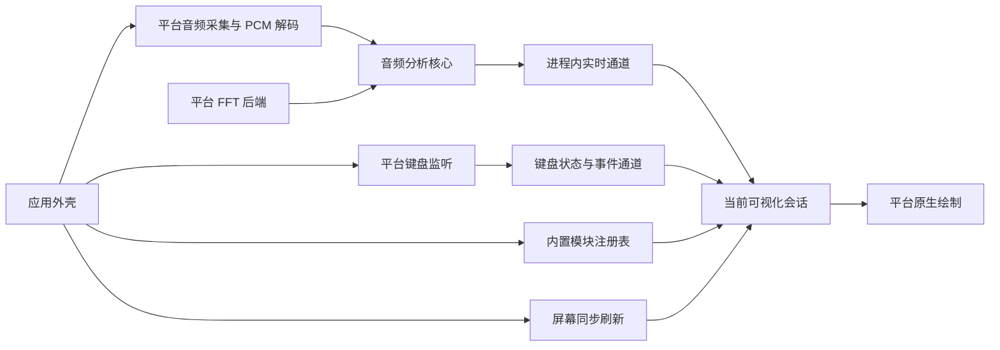

# 输入与可视化分层

Miucs 的输入侧包含并行的音频特征生产与键盘事件生产，可视化在同一帧消费两路数据。平台适配负责系统采集、数值后端、原生绘制；应用外壳把它们组合起来。macOS 为已实测平台；Windows 新增独立 .NET 8/WPF、WASAPI 与物理键监听实现，Linux 核心测试及交叉构建已验证，Windows 实机验收待完成。

音高路径将原始混音直接送入 `MelodyAnalyzer`：频谱峰插值、有界局部白化、谐波显著度、音调性/支持度可靠性判断与相邻候选连续性。`AudioAnalysisPipeline` 将同一 PCM 直接交给主旋律和特征分析器，格式改变时重置音高历史；没有来源切换、模型推理或分离延迟补偿。`StreamOutput` 在后台准备 FFT 状态，实时音频队列只推进原生分析。旧的来源偏好不再读取。

## 目录与依赖

| 目录 | 职责与允许依赖 |
| --- | --- |
| `contracts/` | 语言无关的字段、单位、时间语义、版本、Schema 与合成样本 |
| `modules/audio/core/` | PCM 数据模型、分析算法、FFT 后端接口和实时通道；只用 Foundation |
| `modules/audio/platforms/macos/` | ScreenCaptureKit、CoreMedia 解码、恢复、Accelerate FFT；依赖音频核心 |
| `modules/keyboard/core/` | 按键值类型、修饰状态、按住时长、敲击频率和独立订阅；只用 Foundation |
| `modules/keyboard/platforms/macos/` | 只读 CGEventTap、输入监控权限、安全输入及休眠恢复；依赖键盘核心 |
| `modules/visualizations/api/` | 模块描述、会话、视口、通用 RGB 笔色、注册和消费调度；只用 Foundation |
| `modules/visualizations/api/platforms/macos/` | 原生扩展协议、公共笔色到 AppKit 的转换 |
| `modules/visualizations/pencil-flight/core/` | 特征映射、运动、管道、粒子、纯颜色数据和示例场景 |
| `modules/visualizations/pencil-flight/platforms/macos/` | AppKit 绘图与旧版配色兼容 |
| `modules/visualizations/staff-note/core/` | 固定高音谱位、音符运动、起音绕符头倾摆、有界旋律轨迹、独立键盘布局/星爆与拍点圆环状态 |
| `modules/visualizations/staff-note/platforms/macos/` | 物理键码映射，透明五线谱、音符、轨迹与可复用星形及圆环图层池，接收公共笔色 |
| `apps/macos/` | 入口、菜单、透明窗口、显示刷新、位置偏好、模块组合注册 |
| `tools/macos/` | 数值诊断、文件分析、离线示例导出和性能测量 |
| `tests/` | 契约、通用音频、场景规则与各平台集成验证 |

通用 API 不出现原生视图、颜色或 Combine 类型；原生扩展单独归入 `platforms/`。音频核心不引用任何飞鸟或窗口对象。macOS 与 Windows 平台实现互不引用。`scripts/check-boundaries.py` 检查当前 Swift 源码的这些约束，`test-contracts.sh` 和 `test-flight.sh` 不链接 Apple UI、采集或 Accelerate 框架。

这些目录是源码与依赖边界：macOS 由 `swiftc` 分组编译；Windows 由 `apps/windows/Miucs.Windows.csproj` 组合各 Windows 目录的 C# 源码。没有跨语言二进制 SDK 或动态插件加载。Windows 的数值、事件、场景和窗口偏好在独立可移植测试中验证，原生平台检查见 `docs/windows-acceptance.md`。

## 音频生产与数值后端

`AudioPCMBlock` 是平台无关的 Float32 声道数组。原生解码将 `CMSampleBuffer` 转换为此输入；系统权限、休眠/设备变化、重连与退避留在 macOS 适配。

`AudioAnalysisPipeline` 在通用目录编排两个分析器，保留原有窗口、步长、Float32 缓冲、FFT 输出与归一化流程，通过注入 `SpectrumTransform` 执行变换。macOS 使用原有 `vDSP_DFT_Execute`；通用目录没有 Accelerate 调用。Windows 在 `modules/audio/platforms/windows/Core/` 提供独立 C# FFT/分析移植，以公共契约和合成数值验证，不直接加载 Swift 二进制。格式变化时清理上一格式的旋律缓存，等待新的完整旋律窗口。

`AudioFeatureAnalyzer` 内的 `BeatTracker` 复用混音频谱变化与低频能量，输出独立节拍状态，不依赖人声分离/音高模型。

采集队列串行运行基础特征与旋律分析，直接写入 `FeatureChannel`。生命周期错误才切回主线程；每个特征帧不再创建主线程任务或发布 Combine 数据。可视化只拿到只读 `AudioFeatureSource`，没有启动或停止采集的接口。

恢复看门狗通过最近 PCM 的接收时间先判断健康，新数据持续到达时跳过设备探测。必要的 Core Audio 输出设备查询在后台执行，返回后重新检查采集代次、运行和取消状态；主线程只处理恢复决策。

## 实时通道与时序

通道用短锁保护内存值，不执行回调或 UI 工作，不逐帧序列化。连续状态只有一个最新快照；起音和节拍各保留最多 64 个，超过 250ms 或容量时丢弃最旧项；频谱变化用单调最大值队列保存最近 250ms 的未读区间峰值。订阅者有独立游标，互不排空彼此的事件。

消费者每次屏幕刷新读一次。帧通过 `sessionID + sequence` 去重；同一帧不会反复重置动作。短事件即使下一帧已恢复平静，也能在后续刷新触发。多起音在飞鸟会话中合为一次振翅；其他模块可自行逐个处理。切换或恢复显示时新建订阅，从当前序号开始，不补播先前动作。

每次采集重建产生新 UUID，同时清理快照和事件。旧队列的迟到回调因代次不符被拒绝；消费者收到新代次后清除自己的输入历史。音频窗口中心时间用于音高和测量时间线，主机单调接收时间用于事件过期、帧龄和恢复看门狗，二者不混算。

普通显示不保存帧历史；诊断显式打开独立记录抽头，最多 10,000 帧，读取最新快照不会丢掉诊断帧。诊断仅保存特征数值，不保存实际采集 PCM 或屏幕内容。

## 可视化与应用外壳

`VisualizationRegistry` 保存稳定 ID、名称、`VisualizationLayout` 与创建新会话的工厂。布局包含基准宽高和宽度上下限，默认值兼容飞鸟。`VisualizationController` 仅管理当前会话、两路独立订阅和视口，不持有音频或键盘采集对象，因此切换不会中断输入。

`KeyboardEngine` 与 `AudioEngine` 由应用外壳分别持有并同时启动。键盘采集在专用线程回调中将数字事件写入 `KeyboardChannel`，不读取字符、不逐键分发主线程任务。控制器每帧先传递 `receive(keyboard:)`，再执行音频 `update(input:deltaTime:)`；任一路未授权都不阻断另一路。五线谱在同帧推进独立的键盘星爆，飞鸟沿用默认空实现。权限、事件容量、时间语义与验证见[键盘输入契约](../contracts/keyboard-input/README.md)。

`PencilFlightSimulation` 是通用飞鸟会话，`SoundFlightWorld` 管理场景规则。原生 `MacPencilFlightSession` 组合通用会话、`PencilFlightView` 和调色盘；绘制对象不再订阅音频、持有计时器或管理窗口。

`StaffNoteSimulation` 消费相同通道，`StaffPitch` 按自然音级映射真实谱位，`StaffPitchTracker` 按新音频时间戳过滤短暂异常并分级确认大跳。`StaffNoteScene` 分开管理确认后的准确谱位、平滑位置、绕符头中心的倾摆角度与最多 512 点/8 秒的轨迹，轨迹另做 25ms 轻度平滑。已停止末端连接的至少 80ms 缺口，在真实新点上附加独立的 `StaffTraceJoin` 展示时间；渲染器用同一条三次曲线的两个子段逐渐接拢，约 190～300ms 后成为完整曲线，复用既有轨迹图层和屏幕刷新。音量不进入谱位计算。`MacStaffNoteSession` 组合这一会话与 `StaffNoteView`，旋转仅作用于符干和符尾；没有依赖飞鸟核心；节拍使用通道中新增的可选 `audio.beat` / `beats` 字段。详细规则见 [五线谱音符](staff-note.md)。

`StaffKeyboardStars` 与音频场景分开计时，最多保存 16 次星爆、112 颗星。`MacStaffKeyboardLayout` 将虚拟键码映射到不依赖平台的 ANSI 主区布局；左右修饰键的按下状态由采集适配层解码。普通键长按使用屏幕刷新推进，忽略系统重复事件；权限/代次变化取消旧长按，完整帧间隔负责淘汰粒子，长帧不追赶积压。`StaffNoteView` 缓存一条五角星路径和 112 个原生图层槽，只更新位置、旋转、大小和透明度，层次位于轨迹之上、音乐标记之下。

`StaffBeatRings` 独立消费拍点事件，每拍在随机落点生成两层轻弧主波，延迟 100～210ms 依次放出三道小弧线；主波中心固定，小弧线按预先保存的方向向外移动，整组在 890ms 内消失。最多保留四拍、复用二十个波纹槽，每槽三组双描边路径形成由浅至深的弧线端点，路径全部预缓存。落点与音符状态无关，只在新事件时采样，相邻落点横向至少相隔 120 点；描边宽度抵消半径缩放，上下边缘使用缓存渐变遮罩；不改变谱位、倾摆或缩放。长帧按实际时间淘汰，超过 150ms 的事件不补播。

全局颜色由 `VisualizationAppearanceStore` 保存为一个预设 ID，菜单提供五种笔色。`VisualizationController` 把纯数据的 `VisualizationAppearance` 交给当前会话，并在切换后的激活前传给新会话。两种原生适配只负责将公共 RGB 转成实际笔触；颜色更新不新建会话、不重订阅特征，也不清理音高轨迹。旧 `PencilColor` 是公共 `VisualizationColor` 的兼容别名，旧配色数据用于首次迁移；正常应用入口使用统一菜单。详见[笔色说明](appearance.md)。

`VisualizationHostView` 管理屏幕同步刷新、当前原生视图和通用状态提示，以及拖动/缩放交互。`VisualizerPanel` 按模块布局保持比例，菜单预设、拖动缩放和提示使用同一逻辑坐标，不拉伸长条文字。切换时先保存旧窗口状态并暂停刷新，替换会话与视图，恢复新模块尺寸并传递视口，最后激活；音频持续运行。首次切换沿用左上角位置并限制到屏幕内。隐藏窗口切换时不启动刷新。

各模块独立保存位置与尺寸，`MiucsSelectedVisualization.v1` 保存选择；未知 ID 回退飞鸟。新模块使用 `MiucsVisualizationFrame.v1.<id>` 与原生保存名 `MiucsVisualization.<id>`。隐藏窗口停止刷新而音频继续；切换会话关闭旧模块设置界面并取消其订阅。新增内置模块只需实现会话与平台适配、声明布局，再在 `BuiltInVisualizations` 注册，无须修改音频分析。

兼容项保持 `com.miucs.app`、`Miucs Dev` 签名策略、`MiucsPencilFlight` 窗口保存名、`MiucsPencilFlightFrame` / `MiucsPencilFlightWidth` 以及原配色偏好。现有带宽距离、响度体积和气团效果均属于飞鸟核心。

## 验证入口

运行步骤见 [CONTRIBUTING.md](../CONTRIBUTING.md)。重点证据包括通道积压/峰值/事件过期、并发读写、重连隔离、模块切换与原生视图释放，以及原有数值、旋律、恢复、飞行、窗口、配色测试。合成导出器与性能工具继续调用生产绘制路径，公开资源不包含真实桌面或声音。

原分层重构的回归、数值对照、原生刷新及真实采集记录见 [分层验收汇总](validation/architecture-validation.json)，其中源码哈希对应当时版本。新增五线谱的规则、布局、绘图与回归记录见 [五线谱验收说明](staff-note.md)。

### 像素音乐键盘

`MacPixelKeyboardSession` 组合独立的 `PixelKeyboardScene`、`PixelHeadScene` 与 `PixelTailScene`，不再嵌入五线谱模拟或绘制器。屏幕左侧保留 64×64 像素猫头，以键盘通道的敲击频率控制下巴支点旋转；新按下才启动、重复与修饰键不计速，音频代次不影响它。中间留白，右侧纯黑尾巴优先由可靠拍点驱动；节拍未锁定或失联时，对有效起音作短促响应，不放宽 BPM 识别门槛。尾巴横向伸展，预缓存静止姿态及 4 档幅度 × 64 相位的 2 点像素矢量路径，根部固定，弯曲滞后传递到尾尖，节拍平滑控制速度与起伏，静音或节拍失联后回正；同帧仅接受最新且未过期的事件，不积压动作。键盘拥有独立代次和事件游标，音频重连不重置猫爪。Windows 的 `PixelKeyboardView` 直接继承通用 `VisualizationView`，使用对应的独立尾巴状态与冻结绘图缓存。

## Shared UI plugin migration

The opt-in Lua/Skia path and its acceptance gates are documented in [plugin-migration.md](plugin-migration.md). Capture stays native. Folder packages, the stable input/scene boundary, isolated workers and platform presentation adapters live under `modules/plugins` and `plugins/builtin`. The old renderers remain the baseline until the cross-platform gates pass.
