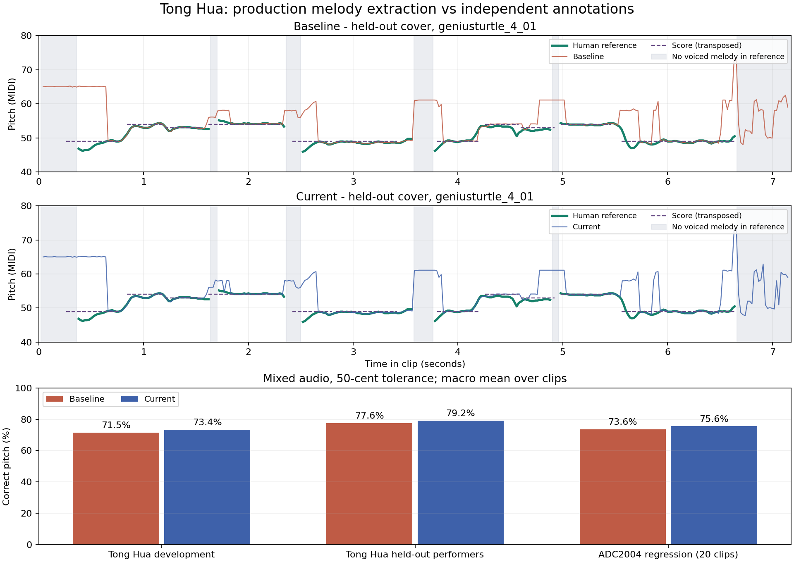

# 《童话》主旋律识别对照

2026-10-24。用有独立参考的真实音乐检验共享 `MelodyAnalyzer`，分别记录实际音高误差、谱面音符一致性和伴奏误报。五线谱固定音高对应固定谱位的规则保持不变。

## 音源与参考

选择光良《童话》。音源使用 **MIR-1K 的真人卡拉 OK 翻唱与伴奏**，并非光良的商业原唱录音。三位演唱者共 31 段、230.82 秒：`fdps_2` 的 12 段用于开发，`Ani_2` 的 7 段和 `geniusturtle_4` 的 12 段在参数确定后用于验证。它们是同一首歌的不同演唱，不能称为跨歌曲泛化测试。

- [MIR-1K 论文与数据说明](https://scholars.lib.ntu.edu.tw/entities/publication/9e597b0a-32e2-4cb3-87d8-c1bcacd482e4)：伴奏、人声分别录在左右声道，并提供人工音高标注。
- [下载镜像](https://github.com/ryanwhite04/MIR-1K)：固定到 `f7d843ce64e09bc8156fff8a49fecbac92501a01`，逐文件验证 SHA-256。镜像中另一份写着 MIREX09/10ms 的 readme 不适用于这里的 MIR-1K `.pv`；本测试使用 20ms 步长、首帧中心 20ms，并检查标注长度和音频时长。
- [独立参考旋律谱](https://edm01.chiding.com.tw/_files/ugd/91a873_8eff3439c5024e09b9b9bbeb876e63fa.pdf)：PDF 第 21 页、印刷页码 20，《童話》，C 调旋律谱。它是公开编配参考谱，不冒充作曲者手稿。单独核对开头 12 个音在两段录音中的位置，按翻唱调高和八度统一移调 −18 个半音；对齐来自人工标注和乐句位置，不使用待测算法选择最佳偏移。

输入分析器前先将原始左右声道等权混成单声道，再用 `scipy.signal.resample_poly` 转为 48kHz PCM16。**主测试不向分析器提供分离的人声**，也不使用谱面、歌词、歌曲名或参考音符指导生产算法。下载的音源、完整谱书和逐帧预测只留在忽略的 `build/`；仓库保存校验和、少量对谱音符与统计结果。

## 评分方法

完整片段采用 MIR-1K 人工标注的实际演唱基频。预测时间是分析窗口中心，匹配最近标注；误差小于 50 音分视为正确。漏检计错，八度错误单独统计，人声无基频的区间仍输出音高则计为误报。先逐段计算，再对片段取算术平均，不通过挑选最佳移调、时间偏移或动态时间规整提高成绩。

谱面对照是另外的音符级检查：在预先对齐的音符区间内取预测中位数，至少一半的预测帧有输出才参加判定。真人演唱存在滑音、起音偏低和跑调，所以谱面的离散音符不能直接代替每帧的真实基频。

基线来自 Git `7bfa4fb` 的生产分析器；新旧版本使用相同输入、解码器和评分程序。另用 ADC2004 全部 20 段做回归，覆盖流行、爵士、歌剧及合成音乐；其中原比赛开发集 10 段参与方案比较，另外 10 段在选定参数后验证。

## 结果

| 样本 | 原音高命中率 | 改进后 | 变化 |
| --- | ---: | ---: | ---: |
| 《童话》开发演唱者，12 段 | 71.50% | 73.36% | +1.86 个百分点 |
| 《童话》另外两位演唱者，19 段 | 77.59% | 79.21% | +1.62 个百分点 |
| 《童话》全部 31 段 | 75.23% | 76.94% | +1.71 个百分点 |
| ADC2004 全部 20 段 | 73.65% | 75.60% | +1.95 个百分点 |

整体有小幅提升，但没有达到“可靠只跟人声”的程度：

- 《童话》无基频区间的误报率为 **98.88% → 98.91%**，基本未改善；这里包含人声停顿和清辅音，不等同于整段没有歌声。
- 《童话》的八度错误率 **2.09% → 2.70%**，其他错音 **22.60% → 20.26%**。降低了部分错音，同时增加了少量八度错误。
- ADC2004 也有退步片段，最明显是 `pop3` **73.37% → 66.86%**；完整报告保留全部结果，不只展示提升的曲目。不能据总体平均值宣称每首流行歌都更好。
- 开头 12 音的谱面对照，两段录音均为 **7/12 → 7/12**；对应人工实际演唱音高的中位数与谱面分别为 8/12、7/12。因此这一小段的对谱指标尚未改善，不能把逐帧提升宣传为完整自动扒谱准确率。



完整机器可读证据：[结果与逐曲指标](validation/tong-hua-benchmark.json)、[固定样本及参考谱检查](../tests/fixtures/melody/tong-hua.json)。图中的灰色区域是人工标注没有演唱基频的区间，可直接看到伴奏误报仍然存在。

## 本轮修改及诊断

仅对开发演唱者做过一次额外的人声单轨诊断：原算法的音高命中率约 **95.96%**，同样演唱混入伴奏后为 **71.50%**。单轨诊断不纳入主测试成绩；它表明当前主要困难是从混合声中选对主线，而不是单音测频精度不足。

本轮保留轻度的局部频谱归一化：对谱峰附近 `±max(100Hz, 0.3×频率)` 范围求平均功率，使用 0.1 次幂做有上限的增益补偿，最大约 2.512 倍；随后以 1.2 次幂保留强峰对比，减少多个弱泛音叠加抢走候选。它属于局部频谱白化的轻量近似；[旋律提取研究](https://www.justinsalamon.com/melody-extraction.html)中对谱峰、谐波显著性和主线选择的区分也解释了为何最大频点不等于主旋律。本实现并非论文中的完整 MELODIA。

白化在原始频谱的噪声门控之后运行，不添加预测等待，不改变音高范围和参考调音，不从谱面强制纠正音符。缩短分析窗、简单频率倾斜、长时平滑、相位修正及更复杂的候选跟踪在开发对照中没有稳定优势，没有加入生产代码。

合成测频、缺失基音、复音增益/极性、反相立体声、44.1/48/96kHz、分块一致性与响应时序检查通过。受控跳音仍在样本交付后 **70 / 50 / 50ms** 给出新音高；这不是系统采集到屏幕显示的端到端延迟。离线原生探针另外逐帧记录分析耗时，详见报告的 `currentPerformance`，不包含 UI 绘制。

后续识别方案的主要方向是人声存在判断与人声优先的旋律提取，或低延迟人声分离后的基频估计。应同时降低无基频区间的误报、八度错误和短错音，并用更多未参与开发的歌曲验证；不能继续靠限制显示音域掩盖错音。当前启发式结果仍需保留其不确定性。

## 复现

需要 macOS、Swift 6、Accelerate/AVFoundation；离线工具依赖见 `tests/requirements.txt`。第一次下载固定片段：

```sh
python3 -m pip install -r tests/requirements.txt
python3 scripts/benchmark-pop-melody.py --prepare --adc-dataset build/adc2004 --diagnose-vocals
```

ADC2004 从[LabROSA 数据页](https://www.ee.columbia.edu/~dpwe/LabROSA/projects/melody/)取得；若本地没有该数据集，可先省略 `--adc-dataset` 运行歌曲测试。后续已有音源时省略 `--prepare`。脚本不播放声音、不采集系统音频、不访问键盘，不改变正在运行的应用。

报告包括源码及输入哈希、逐片段命中/漏检/八度/误报、谱面检查明细、分组统计、分析耗时和诊断边界。改变算法后可以重复同一命令比较，后续若据验证集继续调参，需要重新留出其他歌曲，不能继续把已使用的验证结果宣称为未见数据。
