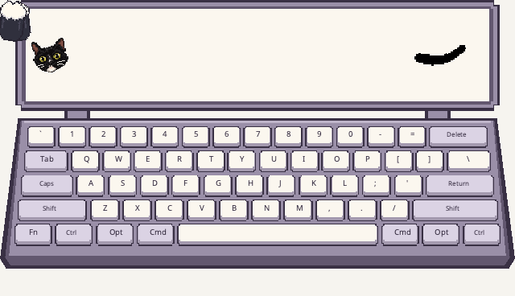

# 像素音乐键盘

工作台使用统一合成输入生成的 12 秒循环 GIF，无声。查看[全部插件预览](plugin-previews.md)。

第三个内置模式：横向留白显示屏、逐键绘制的像素键盘、左右黑猫白手套猫爪。屏幕最左边放置根据用户照片转制的透明像素猫头，保留黄绿色眼睛和白下巴；头像占 64×64 点；右侧纯黑像素尾巴横向伸展约 80 点长，活动区域为 x=652～748、y=40～128，中间 x=116～638 留白。画布 800×460，宽度 80～1600，保持比例并服从屏幕可用范围。使用现有悬停锁、拖动、缩放及各模块独立位置保存。

## 音乐与按键

- 屏幕不再绘制五线谱、旋律轨迹、音名、星爆或涟漪。独立五线谱模式保持原样。尾巴消费现有拍点事件，连续扭动的弯曲从根部传向尾尖，尾根固定，尾尖圆钝、轻轻上翘并滞后跟随，尾身约 12～15 点粗并带少量像素毛边；BPM 平滑控制运动速度（约两拍一个完整周期），拍点强度影响起伏，弱拍也保留明显摆幅；起摆响应时间常数为 55ms，尾尖最大起伏约 ±13 点，不在新拍点强行翻向或重置相位。
- 节拍模式只接收 150ms 内、置信度至少 0.45 的 50～200 BPM 拍点。BPM 尚未锁定或拍点超时后，使用 150ms 内、强度至少 0.18 的有效起音触发短促扭动，保持约 420ms 后衰减；起音间隔至少 120ms，不将起音解释成稳定 BPM。可靠拍点优先，同帧不重复触发，也不积压旧动作。静音、音频失联或事件超时后约 300ms 回到静止姿态；隐藏立即复位，恢复不补播历史事件。
- 猫头沿用原图，绕下巴附近的固定支点左右轻摇，最大 ±12°。频率为最近一秒普通按键次数 × 0.4Hz，最多 2.4Hz；速度平滑过渡，快慢只影响频率。系统重复和修饰键不计入打字速度，必须收到新的有效按下才开始摇头。停输后平缓回正；安全输入、权限丢失、丢失事件、隐藏与代次变化复位，恢复不补播旧动作。音频重连不影响摇头。
- 键盘覆盖 ANSI 主键区五行，按物理键码映射，不依赖输入法。键帽显示固定布局名，macOS 底行用 Fn/Ctrl/Opt/Cmd，Windows 用 Ctrl/Win/Alt。功能键、方向键、导航区、小键盘首版不显示。
- 左右分区按键各驱动一只爪；同一帧多键同时按下全部显示压下状态，每只爪落向该侧最近一次按下的键，空格两爪交替。小爪允许遮挡键帽下半部。
- 下压键帽变为珊瑚色并下沉 4 点。爪子短距离移动、下压与回弹，不保存移动队列；快打直接追随最新位置。短敲至少保留 120ms 的视觉反馈，长按保持，忽略系统重复事件，松开停止保持。修饰键左右区分，Caps Lock 每次切换短暂反馈。
- 音乐和键盘权限独立。音频静音、断开、重连不重置爪子。停止监听、安全输入、隐藏和切换清掉按压；恢复仅响应新按下，不补播旧按键。过期事件、丢失释放事件与长帧都不会造成卡键或积压动画。
- 状态提示跟随全局笔色；硬件固定为奶白/灰紫，猫爪固定黑白，尾巴固定纯黑。画面仍遵循全局不透明度。无新增采集源、逐键计时器或文字记录。

## 实现与验证

实现位于 `plugins/pixel-keyboard/`：`keyboard.lua`、`paw.lua`、`head.lua`、`tail.lua` 分别管理硬件、猫爪、猫头和尾巴。Skia 渲染共享场景，尾巴通过精灵图姿态索引更新。托盘猫头由外壳独立维护，不依赖插件 worker。

运行 `sh scripts/test-plugins.sh` 验证运行库、传输、输入生命周期及 600 帧动画参考，使用 `python3 tools/plugins/preview.py` 导出合成 PNG。macOS 宿主选择与热重载使用 `zsh scripts/test-plugin-macos.sh`，Windows 外壳与输入测试使用 `scripts/test-windows.sh`。

合成演示直接喂入音频特征与物理键位事件，不代表真实音高识别评测，也不记录用户输入。当前机器只能执行 macOS 实机验证；Windows 原生效果仍须 Windows 实机或 CI 验收。

造型与动作按[确认的 v2 动画概念](concepts/pixel-cat-tail/tail-motion-v2.gif)重建；生产版保持固定尾根、粗细和稀疏毛边，使用连续相位取代概念逐帧图中的轮廓变化。

猫头打字速度对比：[预览 GIF](concepts/pixel-cat-head/typing-head-preview-v1.gif)（合成输入；使用实际摇头状态和现有原图）。
