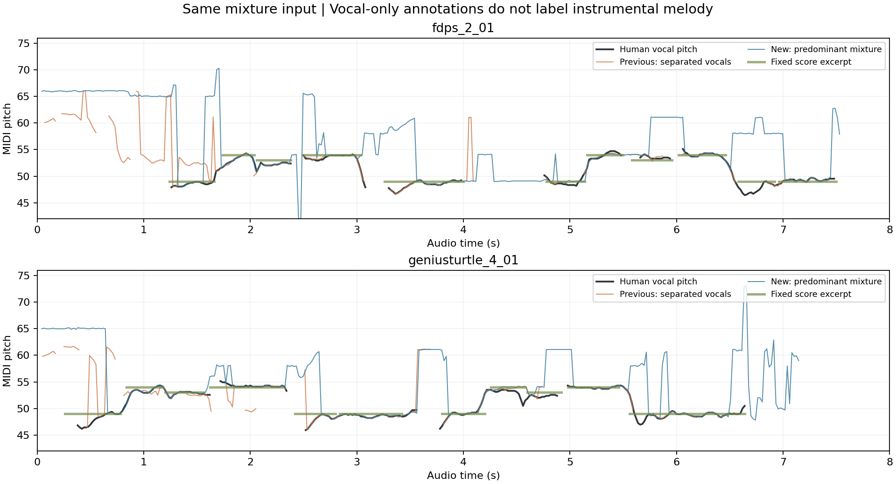

# 混音主旋律

2026-10-26 起，默认直接跟随混音中最突出的旋律。歌声和主奏乐器都可驱动音符；不先判断声源是不是人，也不把最大 FFT 峰直接当作音高。音量、节拍轻弧、键盘星爆、固定谱位与平滑补线同时保留。

## 实现与取舍

本次启用已有、经过混音基准验证的 `MelodyAnalyzer`，没有更换它的阈值或按本轮标注调参。它在 4096 点窗口 / 1024 点步长内插值频谱峰，进行有界局部白化、基频与泛音投票、次谐波惩罚，以及前后候选连续性比较。原始 RMS 需大于 0.0005，选中峰能量集中度需大于 0.42，最终可靠度至少 0.48；不可靠时输出空音高。无可靠候选超过 350ms 后清除旧音高偏好。

五线谱继续只接收 G2～C6；每个音对应固定高度。半音/全音可直接跟随，较大跳跃保留原混音路径的 100/125/150ms 连续确认和半音边界滞回。显示范围限制仅用于谱面，不用来分类人声。静音不报音、不延长旧音符；真实候选恢复后沿用已有的平滑补线。

菜单「音高来源」提供「混音主旋律」和「人声旋律（Rapidly）」。新版首次以混音启动，后续选择保存在 `MiucsPitchSource.v2`；旧 `MiucsVocalSeparation.v1` 不覆盖此次默认切换。保留旧人声分离/CREPE 路径供比较，但混音模式不实例化分离器或 Core ML 模型，也不经过其水印输出。

## 同一音频的配对结果

使用已有 MIR-1K《童话》三位演唱者的 31 段翻唱，总计 230.82 秒。两条路径接收同一份先合成的混音，以 512 点分块推进；旧版为 Rapidly 96ms 试用 + CREPE Tiny + 对齐的 -9dB 相对能量门控。基准完整保留试用水印。人工标注按相同 20ms 网格配对，50 音分内命中，不移动时间、不重新拟合调高；表内是逐片段宏平均。

| 指标 | 重启前人声模式 | 新默认混音模式 |
| --- | ---: | ---: |
| 歌声期间音高命中率（包含漏报） | 71.50% | 76.77% |
| 歌声期间漏报率 | 14.05% | 0.11% |
| 歌声期间八度错误率 | 1.53% | 2.80% |
| 歌声期间其他错音率 | 12.92% | 20.33% |
| 全片段音高输出覆盖率 | 75.40% | 99.69% |
| 每片段少于 200ms 的缺失段数 | 12.23 | 0.74 |
| 每片段相邻候选跳跃超过 7 半音次数 | 6.26 | 13.13 |

31 段中有 24 段歌声命中率提高，7 段下降。输出更连续，但新增输出不全是正确主唱音高，乐器争抢和八度偏差仍会发生。上面的跳跃/缺口是**分析器输出**，还未经过五线谱大跳确认，不代表屏幕上同样数量的跳跃。

歌手休止时，新模式有 98.92% 的参考帧仍输出乐器候选，旧模式为 40.40%。因为标注只有歌声，此项只表示“歌手休止期间仍有输出”，不能直接叫新模式的误报率，也不能证明乐器音高正确。若仍用“无歌声必须不报音”的旧任务评分，整体正确率反而为 68.79% → 59.45%；本次任务已允许主奏乐器，不能混用两个目标宣称全面提升。

固定开头 12 音原谱检查（不更改原时间区间及 -18 半音移调）：`fdps_2_01` 为 **6/12 → 7/12**，`geniusturtle_4_01` 为 **9/12 → 7/12**。两段人工演唱标注与谱面本身仅有 8/12、7/12 相符；不将短谱例作为整曲识谱结论。



## 伴奏、噪声与时延

- 三段独立伴奏控制，新模式输出覆盖率均为 100%，旧模式为 23.14%、26.05%、28.01%。这些片段没有乐器音高标注，覆盖率不等于正确率。
- 固定六音、两种主奏音色、弱和声/低音和噪声鼓点的合成控制，中段音高命中率为 9.09% → 100%。这是已知音高的受控场景，不代表真实歌曲普遍表现。
- 3 秒数字静音，两版均无音高输出；3 秒合成宽带打击噪声，旧版输出覆盖率 31.29%，新版为 0%。这不能保证所有真实鼓组都没有有音高成分。
- 编译与功能测试结束后，串行重跑三段代表音频：每个 512 点块的特征加音高计算 p95 为旧版 2.93～3.59ms、新版 0.105～0.138ms。这里不包含读文件、加载、采集或显示，也不是硬实时保证。
- 48kHz 测试中，输出交付时距分析窗口中心的时间由约 117～128ms 降至 42.7ms。首次需要积累完整 85.3ms 窗口；显示层大跳确认仍需另计，不能将窗口中心年龄当作端到端显示延迟。

完整[配对报告](validation/predominant-mixture-benchmark.json)保留每段退步和源码/输入校验和；[串行性能复测](validation/predominant-mixture-runtime.json)保留完整耗时分布。该语料此前已使用，不是新未见测试集，也不是原唱商业母带。

## 验证与复现

本次旋律、音频管线、采集恢复共 **51 项检查通过**；覆盖泛音强于基频、缺失基频、混音伴奏、反相立体声、不同采样率、增益不变性、静音/噪声拒绝、默认混音及来源切换重连。安装版使用原 `Miucs Dev` 签名，启动日志确认混音路径及 48kHz 双声道 PCM；五线谱窗口恢复。汇总见[安装验证](validation/predominant-mixture-validation.json)。

```sh
zsh scripts/test-melody.sh
zsh scripts/test-audio-pipeline.sh
zsh scripts/test-audio-recovery.sh
python3 scripts/benchmark-predominant-mixture.py
python3 scripts/plot-predominant-mixture.py
zsh build.sh --rapidly  # 同时保留可选的人声模式；默认运行混音
```

基准需要先前已校验的本地样本、Rapidly 与 CREPE 资源；准备步骤见[原始歌曲基准](melody-benchmark.md)、[人声模式](singing-pitch.md)。生产混音模式不依赖这些模型或 Python。
