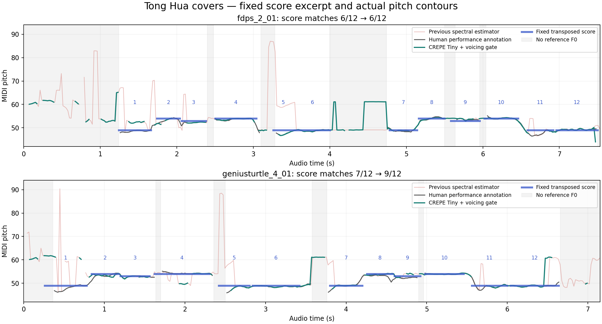

# 歌声音高识别与有效基频门控

2026-10-24，当前本地试用构建使用 **Rapidly → CREPE Tiny → 有效基频门控 → 固定五线谱谱位**。相同音高始终使用同一高度。原始混音仍独立控制音量和起音；键盘星爆独立更新。

## 当前行为

- CREPE 是在音乐和人声音频上训练的单音基频模型，提供音高与周期性可靠度。来源：[原始 CREPE](https://github.com/marl/crepe)、[torchcrepe](https://github.com/maxrmorrison/torchcrepe)。这不是“是否为主唱”的身份分类器。
- 本机使用 CREPE Tiny 的完整 float32 Core ML 模型在 CPU 推理，模型约 2MB；没有 Python 子进程、网络推理或新动画计时器。官方权重及转换脚本有固定 SHA-256，MIT 许可随源码和应用保留。
- 人声 PCM 先做带抗混叠滤波的单声道重采样至 16kHz。模型窗口 1024 点（64ms），步长 320 点（20ms），音高时间戳指向原始 PCM 窗口中心，不把交付时间冒充声音时间。
- 低于 -65dBFS 时不调用模型；进入有效音高需可靠度 ≥0.60 的连续两帧，维持需 ≥0.50。低可靠度或低能量立即发布无基频，不在缺失区间插值，不延用上个音高。
- 明确无基频时，音名淡为 `—`、停止新增倾摆和轨迹末端连接，旧轨迹自然消退。符头保持最后谱位，不飘回中心。暂时没有新数据超过 240ms 也停止延长轨迹。
- 经过门控的歌声换音只再做 40ms 确认；八度及以上为 60ms。原始混音模式保留原有 100～150ms 规则。短确认仍可能过滤很短的真实换音。
- 歌声模式的模型缺失、分离或推理异常会显示“音高暂停”，继续发布原始音量和起音，不自动改为识别伴奏。重新连接建立新状态；采样率、声道变化清空窗口与门控历史。

## 同一份音频上的前后对比

使用已有 MIR-1K《童话》翻唱的 31 段、约 230.82 秒混音。每次同时将 **同一份 Rapidly 人声 PCM** 交给旧频谱算法和新模型，完整保留 Rapidly 试用水印。两者放到同一人工标注 20ms 时间网格评分，边界取共同可用区间；未按结果移动时间轴或修正音高。以下是各片段指标的宏平均：

| 指标 | 旧频谱音高器 | 新歌声模型与门控 |
| --- | ---: | ---: |
| 无有效基频区间误报率（越低越好） | 95.78% | 49.40% |
| 有基频帧漏报率（越低越好） | 0.90% | 18.74% |
| 有基频帧音高命中率（含漏报，越高越好） | 78.99% | 70.67% |
| 八度错误率 | 2.66% | 1.53% |
| 含无基频区间的整体正确率 | 61.90% | 66.22% |

误报减少，但并未消失；抑制误报的同时漏报增加。不能只报整体正确率上涨，而忽略有基频帧命中率下降。正常人声中实际报出的音高更加可靠，并不代表所有人声音符都能被跟上。

## 谱面对照

沿用独立固定的开头 12 音谱例和时间区间；谱面来自[《童话》C 大调编配，第 21 页](https://edm01.chiding.com.tw/_files/ugd/91a873_8eff3439c5024e09b9b9bbeb876e63fa.pdf)，根据这两位翻唱者的调和音区固定移调 -18 半音。该移调在此前基准已确定，不根据本次识别结果调整。固定谱音序列为 C♯3、F♯3、F3、F♯3、C♯3、C♯3，重复两次。

| 翻唱片段 | 旧版 | 新版 | 实际演唱标注与谱面相符 |
| --- | ---: | ---: | ---: |
| `fdps_2_01` | 6/12 | 6/12 | 8/12 |
| `geniusturtle_4_01` | 7/12 | 9/12 | 7/12 |

这只是两段短谱例，没有证明整首歌识谱准确。翻唱中的滑音、跑调与谱面本来就存在差异，因此主要质量指标仍采用逐帧人工演唱标注。谱面和原始标注不作为模型输入。



阴影表示人工标注中无有效基频的时段，绿色空缺是主动拒绝报音。图中绿色仍可见错误平台和漏音，均计入指标。谱例之外没有乐谱级准确率结论。

## 控制样本与性能

真实 Core ML 推理通过了合成静音、白噪声和两种谐波复合音检查：静音与噪声稳定区零报音，A3 与 E4 分别 18/18 帧命中。另用三段**只有伴奏、没有歌手**的输入经过 Rapidly，旧版误报约 96～98%，新版仍约 37～43%。这说明仍会把分离残留当作歌声，不能宣称已经完全解决乐器误识别。详细结果见[控制样本](validation/singing-pitch-controls.json)。

Apple M4 / 32GB，全部 230.82 秒音频的处理累计 49.12 秒，平均实时因子 0.213。每个 512 点输入块的原始特征、分离与音高计算合计，各片段 p95 为 2.87～16.39ms；最慢单块 **312.77ms**，仍有偶发停顿，不保证所有场景无卡顿。该最慢片段的音高阶段最慢约 21.71ms，异常不只发生在音高模型中。所有异常值均保留。该片段三次单独复测 p95 为 3.28、4.52、5.43ms，最慢分别为 4.13、8.89、68.38ms，仍有长尾；见[三次性能复测](validation/singing-pitch-runtime-repeat.json)。

最新音高窗口在交付时通常已距当前约 117～128ms，另有门控、换音确认、系统捕获和显示等待。计算耗时不等于声音到屏幕的总延迟。性能统计排除文件解码、旧版对照计算、首次加载、捕获与显示；文件尾补零只用来排空分离器，不在实时链路补播。

## 复现与限制

```sh
zsh build.sh --rapidly
zsh scripts/test-singing-pitch.sh
zsh scripts/test-audio-pipeline.sh
zsh scripts/test-staff-note.sh
zsh scripts/test-staff-note-platform.sh
python3 scripts/benchmark-singing-pitch.py
python3 scripts/test-singing-model.py
python3 scripts/plot-singing-pitch.py
```

初次准备歌曲样本见[原有基准说明](melody-benchmark.md)。模型仅用 `fdps_2` 开发子集比较门限；剩余 19 段用于回归，但整个语料此前已使用过，不能重新称为未见测试集。没有商业原版母带，也没有无水印 Rapidly 对照。分离质量、水印、和声及伴奏残留仍是限制。

[完整配对报告](validation/singing-pitch-benchmark.json)保存每段指标、输入与代码校验和、真实推理耗时；[安装和验证记录](validation/singing-pitch-integration.json)记录当前应用版本。测试通过数用于判断代码行为，不代表音乐识别准确率。
