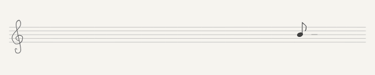

# 五线谱音符



工作台使用统一合成输入生成的 12 秒循环 GIF，无声。查看[全部插件预览](plugin-previews.md)。

当前可视化由 `plugins/staff-note/` 中的 Lua 场景和 Skia 渲染实现。下文原生绘制性能与验收数据为迁移前的历史记录，旧工具已移除。当前回归入口为 `sh scripts/test-plugins.sh`、`zsh scripts/test-plugin-macos.sh` 和 `python3 tools/plugins/preview.py`。

`staff-note` 是第二个内置可视化模块，菜单名为「五线谱音符」。它消费进程内特征通道，音高、起音、音量、节拍和键盘输入同时驱动画面。Windows 使用同一 Lua 插件，平台状态见 [Windows 说明](../apps/windows/README.md)。
由混音主旋律驱动：歌声和主奏乐器都可被选择，保留可靠性与连续性判断。当前配对结果见[混音主旋律](predominant-mixture.md)。


## 画面与音乐映射

基准画面 800 × 160，5:1 比例；宽度范围 80～1600 点，同时受屏幕可见区域限制。实心符头中心固定在 x=640，作为符干和符尾左右倾摆的支点。透明、无边框、鼠标穿透；默认石墨灰，菜单可选择[公共五种笔色](appearance.md)，保留浅色衬线，笔迹的弯曲与排线位置固定。

保持高音谱号和 8 点线距，五条线是 y=58、66、74、82、90。相邻自然音相隔 4 点，八度相隔 28 点；半音统一采用升号拼写，同一自然音与其升音同谱位，由 ♯ 区分。当前只跟随真实音高 G2～C6，超出此音域的候选直接忽略，不压到边界。混音频谱分析器覆盖 E2～C7，两个可视化模块共享其可靠音高标记。

共享分析器的音高选择与显示谱位是两个环节。真实歌曲的识别对照及误报边界见[《童话》基准](melody-benchmark.md)；该优化不会改变同一音高的固定谱位。


谱位由真实音高直接确定：B4 固定在中线 y=74，G4 固定在 y=82，C4 固定在 y=98。相同音高在不同乐段、静音恢复和重新连接后都使用同一目标高度；只有接受新的音高时，符头才平滑移到新谱位。持续音不会自动居中、折叠八度或因近期旋律的平均音高而漂移，已有轨迹也不会整体上下移动。

音名始终显示实际音高，高音谱号保持固定，不显示动态 8 / 15 八度标记。五线谱和键盘星爆位置保持固定。只绘制五条主线，取消高低音的额外加线，避免符头附近出现一叠短横线。这里的 y 向下增加。

| 特征 | 表现与限制 |
| --- | --- |
| 主旋律音高 | 跟随范围 G2～C6；置信度至少 0.48，且 `isMelodic` 为真；半音量化并保留 15 音分边界滞回。半音/全音立即更新，较大变化经 100～150ms 连续确认后更新目标，临界阻尼弹簧约 150ms 收稳 |
| 起音事件 | 角速度脉冲触发符干和符尾绕实心符头中心左右倾摆，连续起音交替施力，角度连续；每侧最多倾斜 20°，约半秒一个回摆周期，阻尼振荡后回正；力度随音量包络和起音强度增加，符头中心保持准确谱位，符头形状、升号和音名不随倾摆旋转 |
| 节拍事件 | 原始混音上的实时节拍跟踪，在随机落点展开两层轻弧水波，带三道小弧线散开；主波最大直径约 64 点，整组约 96 点范围、890ms 内消失，力度轻微影响透明度，音符谱位保持不变；无稳定节拍或静音时不新增 |
| 音量包络 | 按当前乐段的短时分贝范围增强缩放对比，围绕符头中心平滑缩放至约 0.8～1.5 倍，静音回到 0.94 倍；范围向外立即扩张、向内以 3 秒时间常数收敛，最小动态跨度 12dB，稳定长音保持稳定；原始音量包络仍增强起音摆动力度，准确谱位与轨迹不受缩放影响 |
| 可靠旋律历史 | 保留过滤后音名及真实谱位，线条使用 25ms 时间常数轻度平滑；向左每秒移动 70 点、线性淡出，最多 8 秒/512 点 |
| 无有效基频、越界或待确认旋律 | 明确无基频立即停止末端连接、淡出音名并停止新增倾摆；不追加旧音高。音乐持续播放时，后续真实点接回原轨迹，模型缺失和换音不会切线；没有新有效音高达 240ms 也停止末端连接，最后谱位保持不动 |
| 静音、失联或过期音频 | 停止新倾摆，已有角度平滑回正；已有轨迹自然移动、过期 |

首次没有旋律时，在中线以低透明度待机。静音或失联时切开轨迹；持续有声期间，音高过滤本身不再切段。可靠点仍按 8 秒过期，全部过期后末端一并消失，不留下永久横线。帧龄达 400ms 视为过期音频；重连、格式变化、PCM 时间线重置及隐藏恢复清理旧输入历史。新模块或恢复显示使用新通道订阅，旧起音不补播。

造型固定为普通八分音符；不根据音乐推断时值、调号、拍号或和弦，不生成完整乐谱。新模式不显示飞鸟的管道、计分、云朵、气团或调色界面。

## 拍点圆环

原始混音经 `BeatTracker` 跟踪 50～200 BPM 的周期与拍点，通过独立 `beats` 队列触发。每拍随机选择一个落点，两层有留白的主弧相隔 90ms 展开；三道小弧线分别延迟 100、155、210ms 出现，向不同方向轻轻散开。弧线两端淡化，保留浅色衬线和全局笔色，整体略扁（纵向 0.9 倍）。相邻拍点横向至少间隔 120 点，不跟随音符。波纹绘制在音符和音名下方，上下边缘柔和渐隐。首次锁定需要几秒，弱节奏可能不触发。缓存弧线路径与三档端点透明度，复用二十个原生波纹槽，最多保留四次拍点，复用屏幕刷新；静音、失联、隐藏或切换时清空，不补播旧拍点。算法、时间语义与验证见[节拍识别说明](beat-tracking.md)。

## 键盘五角星

键盘和音频同时驱动画面：键盘不影响音高、倾摆、缩放与旋律轨迹；音频静音、未授权或重连也不会清空已出现的星星。没有按键时不显示键帽、键名或键盘轮廓。

`StaffKeyboardLayout` 使用 ANSI QWERTY 主键区的物理位置。每行宽 15 个键宽单位，横向拉伸到 x=80～760，各行中心 y=36、58、80、102、124。数字行退格占 2 单位，Tab / 反斜杠占 1.5，Caps Lock 占 1.75，回车占 2.25，左右 Shift 分别占 2.25 / 2.75，因此 Q、A、Z 保留真实错位。底行从左到右是 Fn、Control、Option、Command、空格、右 Command、右 Option、右 Control；空格占 6.25，其余各占 1.25。爆点使用宽键中心。

macOS 的虚拟键码由 `MacStaffKeyboardLayout` 转成通用键位，不读取字符，输入法不改变位置。首版不包含 F1～F12、Escape、方向键、导航区和数字小键盘。位置适配长条画布，五角星本身保持正常比例；窗口 80～1600 点宽时，位置和星形一起等比缩放。

| 输入 | 星爆效果 |
| --- | --- |
| 普通键首次按下 | 当帧出现中心五角星，100ms 内放大、淡出；6 颗半径约 3～5 点的小星向四周移动 12～28 点，轻微旋转，650ms 内消失 |
| 普通键长按 | 300ms 后首次补发，之后每 180ms 补发较小的中心星和 4 颗小星；忽略系统自动重复，松开立即停止新增 |
| 多键同按 | 各自位置独立爆散 |
| 左右修饰键、Fn | 仅真实按下触发一次；释放不会误触发，另一侧仍按住也能正确区分 |
| Caps Lock | 锁定和解除锁定各触发一次，相同锁定状态不重复触发 |

星形轮廓沿用铅笔描边、浅色衬线及五种公共笔色。绘制顺序为五线谱 / 旋律轨迹 → 星星 → 拍点圆环 → 谱位标记 / 音符 / 音名，不添加背景、光晕或彩色发光。

`StaffKeyboardStars` 独立保存事件游标、长按节奏和有界粒子；`receive(keyboard:)` 暂存本帧快照，统一在音频更新中推进。最多 16 次星爆、112 颗星，超额回收最早一次。五角星路径预先缓存，原生绘制预建并复用 112 个矢量图层槽，不逐键创建计时器或主线程任务。

隐藏和切换模块清空星爆，恢复时重新订阅，不补播隐藏期间的按键。权限丢失、安全输入、监听代次变化及事件丢失会停止旧长按；已有粒子继续自然消失，恢复后只响应新按下。长帧按实际时间淘汰旧粒子，每个仍有效的长按最多产生一次当前补发，绝不循环追赶积压。无音频变化且没有存活星星或圆环时不再请求绘制。

自动检查覆盖键位、修饰键两侧同时按住、事件去重、长按、过期释放、权限/安全输入、重连、隐藏恢复、长帧和粒子上限；原生绘制覆盖五色、600/800/1600 点、浅深背景及音符前景层次。合成演示 GIF 同时展示音频与键盘，未采集或注入真实输入。验证摘要、CPU 数据与真实窗口刷新间隔见 [staff-keyboard-validation.json](validation/staff-keyboard-validation.json)。真实按键端到端验收与合成结果分开记录。

2026-10-23 的星爆版本通过 268 项自动检查，并在安装版中完成实体键盘的打字、长按和松开确认。每秒 20 次按键及满 112 颗星、三种尺寸的主线程 CPU 更新加图层提交 p95 为 0.044～0.317ms，低于 2ms 目标；使用线程 CPU 时钟，另行记录含调度/提交等待的墙钟时间。实际透明窗口在 800 点 / 15 秒及 1600 点 / 10 秒测试中平均约 59.86 / 60.00fps，最长间隔分别为 51.13 / 23.13ms，超过 25ms 分别有 33 / 0 次。CPU 达标不代表所有刷新都按时完成，完整波动数据已保留。

## 短时毛刺过滤

`StaffPitch.resolve` 将五线谱跟随范围收窄到 G2～C6（MIDI 43～84，按半音量化判断），不修改共享音频分析器或飞鸟模块。越界结果不产生边界音符，也不写入旋律采样历史。

`StaffPitchTracker` 只在五线谱模块中处理音高候选。首次可靠音高，以及静音、失联、重连或隐藏恢复后的首音立即采用；相对于最后接受的音高，变化不超过 2 半音时立即响应，保留正常人声的小幅换音和滑音。持续有声期间，没有新结果、越界或标签过期不会清除这个比较基准；明确的无可靠音高结果会清理候选上下文，下一次可靠结果按新起点处理。

| 变化幅度 | 连续确认要求 | 48kHz / 1024 样本步长下的合成输入实测 |
| --- | --- | --- |
| 3～5 半音 | 至少 2 个新结果，跨度至少 100ms | 约 107ms |
| 6～10 半音 | 至少 3 个新结果，跨度至少 125ms | 约 128ms |
| 至少 11 半音 | 至少 4 个新结果，跨度至少 150ms | 约 171ms |

确认使用音频时间戳；重复快照不计数，结果间隔超过 75ms 时重新确认。待确认音高允许在最初候选附近上下 1 半音变化，远处的新候选重新计数。短暂偏离又返回原旋律会被丢弃；确认期间音符保持上一个可靠音高，停止追加采样。仅在有效音高仍新鲜时连接符头，不把被拒绝的候选写成真实音高。明确无基频立即关闭末端连接和新增倾摆，240ms 没有新有效音高也关闭末端连接；后续真实点按下节规则接回历史线。静音或采集失联才结束该段，恢复后开始新段。未确认候选不会刷新旧音高的有效期；越界、缺失或无效结果会清理待确认候选，静音、失联、格式变化和隐藏恢复还会清理音高比较基准。

轨迹采样单独按音频时间间隔做 25ms 的指数平滑，不包含音符本体的摆动、缩放或运动惯性。绘制时将末端 10 点范围平滑接到动画符头，避免音符移动中与轨迹脱开；这一视觉修正不改动采样历史。新段从真实谱位开始；持续音最终回到真实高度，保留八度距离。上述确认耗时从首个新候选算起，不包括采集、音高分析和显示延迟；显示漏帧时还可能更长。

混音分析器先做能量、音调性和谐波支持度判断；上表的确认规则再抑制短暂误选。范围内持续占优的伴奏仍可能被确认，范围外的真实演唱音高和很短的真实大跳也会被过滤。回归使用合成音高序列，包括持续一至五帧的高置信度伴奏式插入、G2/C6 边界、连续越界、真实持续大跳、重复/稀疏输入、过期与断续音高，并检查小幅变化在首帧响应、异常期间轨迹不增加、恢复不绕过确认。结果和各跳跃确认耗时见 [staff-note-tests.json](validation/staff-note-tests.json)。

### 连续轨迹与显示置信度

显示层统一使用混音置信度门槛 0.48，结合 `isMelodic`、数值有效性、音域和换音确认。曾为歌声模型设置的独立置信度和短确认上下文已随模型移除；此前实验数据保留在验证目录。

明确无基频时，音名淡出、停止新增倾摆和末端连接，不延用旧音高。持续收到未静音的原始音乐时，后续接受的真实音高始终接回尚存的上一轨迹点；模型缺失、模型结果过期或音程变化都不再切断历史线。连接只发生在真实新点到达以后，缺失期间不增加轨迹点，也不会持续画出水平拖尾。对至少 80ms 且已停止末端连接的缺口，新点到达后采用水平切线的三次曲线，从两端逐渐生长，按缺口长短在约 190～300ms 内接拢；进度采用平滑缓入缓出，完成后保留同一条曲线。新音符正常响应，接线不等待模型下一帧。

补线计时从收到恢复结果的这一帧开始，不使用已经过了模型延迟的采样时间；重复快照不重播。已有音高点的时间和谱位保持固定，多个短缺口可独立完成连接，长帧直接跳到实际进度。真正静音、失联或隐藏仍按原有规则分段或清理。实现与原生绘图测试、连续缺口压测和刷新间隔记录见 [平滑补线验证](validation/staff-join-validation.json)。

音高确认状态和轨迹分段独立管理：明确无音高时清理候选上下文，不会因此切线；恢复帧仍须满足小于 240ms 的新鲜度要求。原始音频静音、超过 400ms 未更新、断开采集、格式或代次变化、隐藏或切换模块才会断开或清理轨迹。历史按实际时间在 8 秒后过期，全部过期后只显示下一次真实采样，不连接到已消失的旧点。

上一版只衔接 120ms / 5 半音以内的缺口，31 段回放仍有 270 段轨迹，未达到连续绘制的要求；该阶段记录保留在 [staff-neural-continuity.json](validation/staff-neural-continuity.json)。本次对相同缓存做 60Hz 刷新、120ms 模型延迟回放，31 段录音各保留一条连续历史线，原生矢量路径也各只有一个子路径。7884 个接受的音高点及时间戳与上一版逐点相同，变化仅在视觉连接方式。

回放用持续未静音的伴奏状态隔离模型缺失，不能代替实际采集或刷新间隔测量。歌声休止和识别失败都会被视觉连线跨过；它表达连续音乐中的音高走势，不表示连线经过的每一刻都检测到了歌声，也不向音频通道发布推测音高。结果、输入和源码哈希见 [staff-session-continuity.json](validation/staff-session-continuity.json)，原生绘图对照见[上一版](validation/staff-session-continuity-before.png)和[连续版](validation/staff-session-continuity-after.png)。这属于旧人声版本的历史数据。当前插件使用固定数值回放验证连续性。

前一版范围与确认时间调整通过 161 项针对性检查，记录见 [staff-pitch-filter-validation.json](validation/staff-pitch-filter-validation.json)。上一版显示音区与短暂连接记录见 [staff-layout-continuity-validation.json](validation/staff-layout-continuity-validation.json)。恢复限制音域、保持有声轨迹连续并去除加线的记录见 [staff-contour-validation.json](validation/staff-contour-validation.json)。本次移除自动八度居中、固定谱位及保留轨迹连续性的回归与安装记录见 [staff-fixed-pitch-validation.json](validation/staff-fixed-pitch-validation.json)。

## 窗口与生命周期

飞鸟和五线谱分别保存位置、大小；应用记住上次选择，未知 ID 回退飞鸟。飞鸟继续读写原偏好键。切换先保存、暂停刷新，替换会话后恢复布局，再激活；音频连接不重启。首次切换保持左上角锚点，超出屏幕时回到可见区域。

## 绘制缓存与慢帧检查

原生窗口使用保留的矢量图层绘制五线谱、音符和轨迹；显示刷新只提交轨迹路径、位置、缩放和倾摆角度，音名变化时更新独立文字图层，减少整块画布重绘和位图提交等待。离线导出继续使用相同几何路径的 Core Graphics 参考绘制；平台验证覆盖原生图层的符头支点、旋转和五色透明输出。

符头、两种符干方向、升号和排线复用固定路径；原生图层与离线绘制均不再创建额外加线路径。全部 E2～C7 音名及待机横线在视图创建时准备文字样式和离线 Core Text 排版，换色时重建文字缓存。

音频看门狗在持续收到新 PCM 时直接判定采集健康；需要核对输出设备状态时，在后台执行 Core Audio 查询，返回后复核采集代次和取消状态。这样设备探测的同步系统调用不会阻塞界面刷新，旧探测结果也不会影响重连后的采集。

历史原生刷新测量使用合成输入和透明测试窗口；相关探针已随旧绘制器移除。当前性能测量使用插件 benchmark 和 surface probe，见 [插件迁移记录](plugin-migration.md)。

2026-10-23 对照测量中，640 点窗口的 15 秒刷新平均约 60fps，最长间隔从 61.29ms 降至 29.74ms；最终仍有 4 个超过 25ms 的间隔。1000 点窗口的 6 秒测量最长间隔从 49.69ms 降至 28.14ms。顺序测量受系统负载影响，不能据此保证所有场景无掉帧。各阶段数据、验证结果和对应源码哈希见 [staff-render-performance.json](validation/staff-render-performance.json)。

## 新增模块时的验证记录

```sh
zsh scripts/test-keyboard.sh
zsh scripts/test-contracts.sh
zsh scripts/test-visualization-host.sh
zsh build.sh
```

规则结果见 [staff-note-tests.json](validation/staff-note-tests.json)，原生布局与绘图结果见 [staff-note-platform-tests.json](validation/staff-note-platform-tests.json)。测试仅使用合成音高与独立偏好域。合成预览覆盖 600/800/1600 点、透明/浅色/深色背景、G2/C6 边界与待机，重复静帧按像素检查笔迹稳定。

首次接入时共 206 项自动检查通过，独立 NumPy 参考 542 窗口无差异，飞鸟三张静帧与改动前字节完全相同。当时的构建和严格签名校验通过。解锁后原生刷新实测：五线谱约 59.5 fps，绘制 p95 为 0.43ms；飞鸟回归约 59.7 fps。两者隐藏后停止绘制，恢复显示后一秒均绘制 57 帧。测量使用 1000 点宽的真实透明窗口，6 秒内分别出现 1 次和 2 次超过 25ms 的刷新间隔，不代表长期无卡顿保证；源码哈希和性能记录对应首次接入版本。

原生应用已观察到从飞鸟切到五线谱的画面变化，并在新构建重启后恢复五线谱选择、位置与 800 × 160 尺寸；飞鸟原有位置和大小保持不变。修复了应用菜单未随模块刷新设置项的问题，五线谱下设置入口已正确禁用。缩放边界和模块切换生命周期由原生平台测试覆盖。汇总与对应源码哈希见 [staff-note-validation.json](validation/staff-note-validation.json)，详细刷新数据见 [五线谱](validation/staff-note-cadence.json)与[飞鸟回归](validation/flight-cadence-staff-regression.json)。

原生 cadence 测量使用合成采集传输和真实透明窗口，需要显示器唤醒且桌面解锁；不捕获真实声音或屏幕。位图绘制耗时不代表原生呈现帧率。原有飞鸟绘制保持不变，回归对照使用同一合成场景。
