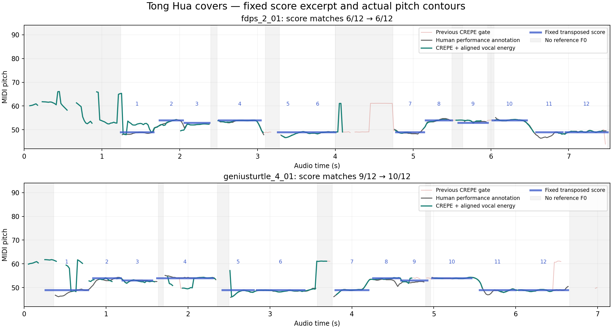

# 人声相对能量门控

> 2026-10-26 起默认使用[混音主旋律](predominant-mixture.md)。本文记录保留的人声模式及历史验证。

2026-10-24，在已推送的 `a55c496`（Rapidly + CREPE Tiny）上继续优化。当前仍使用同一个音高模型，新增**分离后人声与原始混音的相对能量判断**。不修改 Rapidly 的输出、水印或授权逻辑，不增加模型、线程或动画计时器。

## 规则与时间对齐

- 两路都用相同的带抗混叠重采样转成 16kHz，以 64ms 窗口、20ms 步长计算单声道 RMS。
- 人声 RMS 至少达到原始混音 RMS 的 0.3548 倍，即幅度比不低于 -9dB；两者同时受 -65dBFS 的绝对静音门槛约束。这里是能量启发式，不是人声身份概率。
- 通过能量判断后，CREPE 进入门槛为 0.40，维持门槛为 0.30，仍需连续两帧确认。独立的能量条件允许降低周期性门槛，减少原有门控对正常歌声的漏报。
- 参考按**原始样本序号**配对。即使分离器晚交付一批 PCM，也取同一声音窗口的混音能量，不使用交付时刻的最新混音电平。没有新增的音频等待窗口。
- 分离器预热时也积累参考；最多保留 100 帧（2 秒）。缺失或过期参考直接拒绝报音并跳过推理。重置、采样率或声道变化同时清空两路历史，不补播旧结果。
- 原始混音模式继续使用此前的频谱算法。未配置混音参考的独立 CREPE 探针保留 0.60/0.50 规则，作为上一版本的配对基线。

## 实际 Swift / Core ML 配对结果

31 段 MIR-1K《童话》翻唱，合计 230.82 秒；同一遍 Rapidly 输出同时送给旧门控和新门控，完整保留试用水印。采用相同的人工标注 20ms 网格，不移动时间轴、不修正调高；下表为各段指标的宏平均。门槛仅用 `fdps_2` 开发集选择，其余 19 段作回归。整个语料已在此前工作中使用过，不属于新的未见测试集。

| 指标 | 已推送的 CREPE 门控 | 新相对能量门控 |
| --- | ---: | ---: |
| 无基频区间误报率 ↓ | 48.38% | 39.96% |
| 有基频帧漏报率 ↓ | 18.51% | 14.53% |
| 有基频帧音高命中率（含漏报）↑ | 70.67% | 71.00% |
| 八度错误率 ↓ | 1.46% | 1.42% |
| 其他错音率 ↓ | 9.37% | 13.06% |
| 含无基频区间的整体正确率 ↑ | 66.31% | 68.49% |

其余 19 段的整体正确率从 68.36% 到 69.92%，误报从 48.60% 到 41.98%，漏报从 17.67% 到 13.52%。收益并不均匀：31 段中，22 段误报下降、8 段上升、1 段不变；音高命中率仅 17 段上升，14 段下降。放宽周期性门槛带来了更多非八度错音，不能将漏报减少等同于全部补回正确音符。例如 `geniusturtle_4_05` 的误报从 44.9% 升到 73.5%，完整报告保留该退步。

纯伴奏控制样本没有歌手；其误报仍没有消失：

| 样本 | 旧门控 | 新门控 |
| --- | ---: | ---: |
| `fdps_2_01-accompaniment` | 41.76% | 20.74% |
| `Ani_2_01-accompaniment` | 37.30% | 26.37% |
| `geniusturtle_4_01-accompaniment` | 39.50% | 26.89% |

## 原谱与性能

继续采用先前冻结的开头 12 音、固定时间区间和 -18 半音移调，没有按新结果修改谱面。`fdps_2_01` 为 **6/12 → 6/12**，`geniusturtle_4_01` 为 **9/12 → 10/12**。独立人工演唱标注与谱面本来只有 8/12、7/12 相符，短谱例不能替代逐帧人工音高指标，也不能证明整曲识谱准确。



Apple M4 / 32GB，本轮完整处理累计 32.24 秒，实时因子 0.140。各片段每个 512 点输入块的原始特征、参考能量、分离、音高计算合计 p95 为 **3.00～3.40ms**，最慢 **12.31ms**。这里没有把首次加载、文件读写、旧版对照计算、捕获与显示算进处理耗时，也没有删除异常值。不能根据不同运行环境下的上一轮耗时宣称固定比例提速。

音高窗口交付时距声音时间仍约 117～128ms，另加既有确认、捕获与显示时间。12.31ms 超过单个 48kHz/512 点块的 10.67ms 间隔，仍不是硬实时保证。

## 比较过但未接入的方案

先在冻结的同一份分离 PCM 上比较了 [Silero VAD 6.2.3](https://github.com/snakers4/silero-vad)、[FCPE 的两个官方权重](https://github.com/CNChTu/FCPE)、两个音高模型交叉确认以及更严格的连续音高确认。FCPE 只使用最多 32 个已获得的 Mel 帧，候选分别等待 0、40、80ms，没有将整首歌曲的未来数据用于实时结论。

通用语音检测器会漏掉部分持续歌声，FCPE 在开发集的收益没有稳定延续到其余片段。双模型交叉确认只有较小收益，还要增加一个约 40MB 的模型。因此本轮采用计算与资源开销较小的相对能量方案；没有把实验模型打包进应用。实验摘要见[候选对照](validation/vocal-energy-experiments.json)。

## 复现

```sh
zsh scripts/test-singing-pitch.sh
zsh scripts/test-audio-pipeline.sh
python3 scripts/benchmark-vocal-energy.py
python3 scripts/plot-singing-pitch.py --vocal-energy
zsh build.sh --rapidly
```

初次模型及样本准备见[歌声音高识别](singing-pitch.md)和[原始基准](melody-benchmark.md)。[完整配对报告](validation/vocal-energy-benchmark.json)包含逐段结果、代码和输入校验和及真实耗时。模型与分离残留、轻声演唱、和声、试用水印仍会影响表现；这里没有无水印授权版本的对照。
