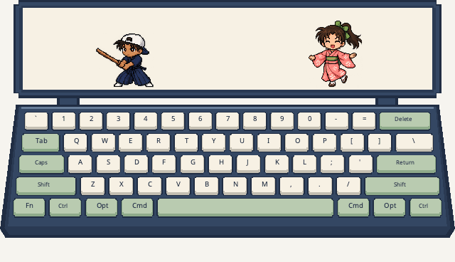

# 平次与和叶 · 像素皮肤



沿用现有像素皮肤的「上方长条角色框＋下方完整键盘」，配色为靛蓝外框、奶油白字母键、浅绿功能键和樱粉按键高亮。左侧是服部平次，右侧是穿和服的远山和叶。

GIF 由工作台以合成输入生成，循环 12 秒、采样 16 FPS，无声；与[其他皮肤预览](../../docs/plugin-previews.md)使用相同输入、种子和时间线。

## 动作

- **平次挥剑**：12 帧模型绘制的木剑动作，包括待机、抬剑、劈斩、随势和收剑。物理按键与修饰键触发动作；最近一秒的实际按键频率控制每次挥剑约 0.30～0.72 秒。连续敲击衔接完整动作，停止后收势。系统自动连发的长按事件不重复触发挥剑。
- **和叶转圈**：8 个方向的模型绘制关键帧，包含正面、左右侧面、背面及斜侧面。可靠音乐节拍驱动转身，两拍一圈；新节拍不把动作重置到第一帧。停止音乐或失去可靠节拍后，完成当前一圈并回到正面。
- 键盘、音乐两路独立：没有音乐也能挥剑，没有键盘权限也能随音乐转圈。物理按键高亮不依赖输入法，不读取输入文字。

角色使用透明图集和最近邻采样。运行时只选择绘制帧并按脚底锚点定位，不旋转整张人物贴图来假装转身。木剑、衣袖和马尾运动来自绘制的姿态。

## 安装与预览

完整构建会自动包含本插件。也可以将整个 `heiji-kazuha` 文件夹复制到用户插件目录，然后在应用菜单执行「重新扫描插件」，选择「平次与和叶」。

- macOS：`~/Library/Application Support/Miucs/Plugins/heiji-kazuha/`
- Windows：`%LOCALAPPDATA%\Miucs\Plugins\heiji-kazuha\`

```sh
python3 tools/plugins/validate.py plugins/heiji-kazuha
python3 tests/plugins/heiji_kazuha_replay.py
python3 tools/plugins/lab.py serve --plugin plugins/heiji-kazuha
```

工作台可暂停、单步和调整打字频率、BPM；也可以测试静音、权限不可用、丢事件和恢复。两路输入使用独立序号及会话，过期事件不补播，长时间卡顿会清除动作积压。画面支持宿主缩放和不透明度，固定主题色不随公共笔色改变。

## 验证与资源

生产 Lua worker 的合成输入回放覆盖动作节奏、全部关键帧、输入独立性、长按、修饰键、重复/过期事件、静音、重连、卡顿、边界和生命周期；本地结果见[验证记录](../../docs/validation/heiji-kazuha.json)。这不替代 Windows 桌面实机验收。

关键帧来源、生成提示词和脚底配准方法见 [ASSETS.md](ASSETS.md)。
