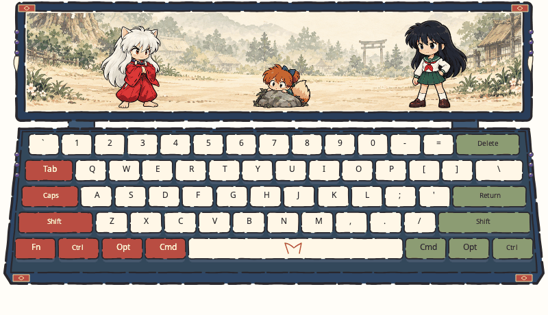

# 犬夜叉

「坐下！」喜剧主题，画面只用动作表达，**没有对白文字和气泡**。上方是御神木与村落背景、犬夜叉、戈薇和七宝，下方保留完整五行键盘。



- 新按键让犬夜叉抬头逞强，键帽泛起珊瑚色。持续按住不重复触发，和弦保持多键反馈。
- 第一枚可靠且足够强的音乐拍点、随后每四枚合格拍点触发一次指地联动。戈薇抬手指地，犬夜叉被念珠拉下，七宝受惊躲藏再偷笑。
- 一次联动约 1.94 秒，落地时尘土与七宝反应同步。密集输入不能打断扑地或爬起；忙碌时的拍点不排队。
- 静音时不产生新动作，已开始的联动自然收尾。待机只偶尔眨眼。隐藏、重新激活或长卡顿后不补播。
- 深靛蓝框、暖白键帽、左侧朱红和右侧鼠尾草绿修饰键，边框点缀念珠、犬牙及菱纹；空格键有小狗耳轮廓。

40 个模型绘制帧：犬夜叉 16、戈薇 12、七宝 8、尘土 4。固定锚点、固定像素比例，动作来自图集原始帧。见[关键帧与时序](../../docs/concepts/inuyasha/keyframes.md)、[资源来源与提示词](ASSETS.md)。

## 安装与验证

将本目录放入 Miucs 用户插件目录，在可视化菜单中选择「犬夜叉」。插件 ID 为 `inuyasha`，入口 `main.lua`，画布 800×460。

```sh
python3 tools/plugins/validate.py plugins/inuyasha
python3 tests/plugins/inuyasha_replay.py
python3 tools/plugins/inuyasha_preview.py
```

预览由合成键盘/音频输入驱动实际 Lua worker 和 Skia 渲染器生成，并非真实音乐录屏。键盘和音频使用独立会话与去重游标，拒绝过期、未来、丢失和低置信度事件。
