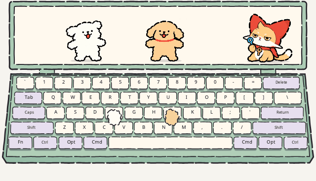

# 麦芬



工作台使用统一合成输入生成的 12 秒循环 GIF，无声。查看[全部插件预览](../../docs/plugin-previews.md)。

按已确认的第三版概念图实现的 Miucs API v1 独立皮肤，菜单名称为「麦芬」。

- 奶油白、草绿色键盘；屏幕、每个键帽、双爪与角色采用断续手绘轮廓。键盘线条在创建时固定，运行中不随机闪烁。
- 左侧物理键（1–5、Q–T、A–G、Z–B 与左修饰键）让马尔济斯起跳；右侧键让小金毛起跳；空格交替触发。仅真实新按下触发，长按重复不触发。
- 两只小狗各使用生图模型绘制的 16 帧跳跃图集，一次播放约 690ms，包含蓄力、蹬地、腾空、落地与恢复。代码只计时、选帧，不计算位移轨迹、不缩放或旋转角色。密集击键最多保留一个近期动作，不中断落地或累积长队列。
- 键帽显示实际多键保持状态；两只爪跟随最后按下的键，松开后原地抬起。
- 可靠音乐节拍让麦芬吹出一颗泡泡：先在吹棒旁膨胀，再向左上漂移并淡出。最多 8 颗、每颗 1.85 秒；没有节拍就不生成。
- 音频和键盘独立重连、去重和过期检查。恢复后不补播隐藏期间的输入；系统采集、鼠标穿透、拖动与缩放使用原宿主。

## 安装

完整复制本文件夹到 `~/Library/Application Support/Miucs/Plugins/muffin-puppies/`（macOS）或 `%LOCALAPPDATA%\Miucs\Plugins\muffin-puppies\`（Windows），菜单「重新扫描插件」后选择「麦芬」。

工作区版本也会由现有构建脚本自动打包。与旧皮肤使用不同 ID 和独立的大小、位置偏好。

## 验证与预览

```sh
python3 tools/plugins/validate.py plugins/muffin-puppies
python3 tests/plugins/muffin_replay.py
python3 tools/plugins/preview.py --plugin plugins/muffin-puppies
python3 tools/plugins/muffin_preview.py
python3 tools/plugins/lab.py serve --plugin plugins/muffin-puppies
```

当前逐帧版本可查看 [GIF 预览](../../docs/concepts/muffin-puppies/frame-jump-v2/runtime-preview.gif) 或 [WebP 预览](../../docs/concepts/muffin-puppies/frame-jump-v2/runtime-preview.webp)，由正式 Lua worker 与 Skia CPU 绘制器接收合成输入生成。它不是桌面录屏，未验证真实系统音频/键盘权限，也不代表 Windows 实机验收。

两只狗的身体、耳朵、四肢和地面阴影均由模型逐帧绘制。图集排布并非精确机械网格，工具按图中地面阴影读取固定大小的帧区域，仅做配准，不修改原图像素，也不添加跳跃轨迹。AI 生成帧仍有轻微轮廓差异。麦芬与泡泡沿用已有实现。

如需重新配准图集，先安装 Pillow 与 NumPy，再运行 `python3 tools/plugins/register_muffin_jump.py`；正常运行皮肤不需要这些 Python 依赖。
