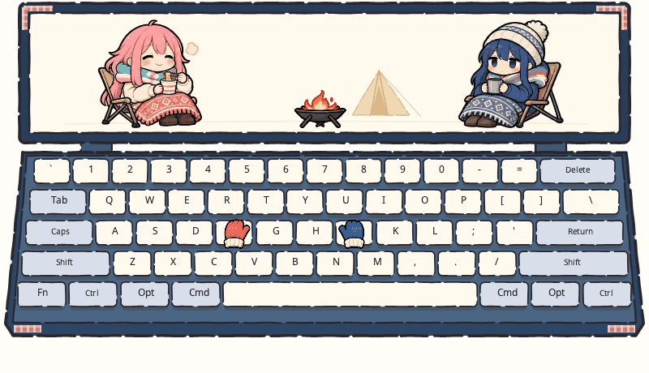

# 摇曳露营



Miucs API v1 独立皮肤，依据确认的概念图制作。沿用上方横屏与下方五行 ANSI 键盘：抚子坐在左侧吃杯面，凛在右侧捧热饮，中间放小篝火和淡色帐篷。奶油键帽、深蓝框、珊瑚格纹包角与左右针织手套。

## 动作与输入

- 新按键启动抚子的 12 帧吃面动作：挑面、靠近嘴、吸面、满足地眯眼、放低筷子，一次约 1.05 秒。左右分区和空格都可触发。长按重复不触发，密集打字只保留一个 200ms 内的近期动作，不打断当前这一口，不积累长队列。
- 左右针织手套各 4 帧：悬停、弯曲、压下、回弹；跟随各自分区的最近按键。真实多键保持、修饰键、Caps Lock 与释放沿用原键盘逻辑，压下为暖杏色。
- 每个可靠音乐拍点让篝火播放 8 帧轻跳，约 0.26–0.36 秒；高 BPM 时仅缩短播放时长，不缩放火焰。静音后保留低火静帧。
- 首个拍点及之后每四拍尝试启动凛的 12 帧轻啜：捧杯、举杯、小口喝茶、回到胸前，一次约 1.6 秒。上一口没结束时跳过本次，不快速重复举杯。
- 没有真实拍点就不追加音乐动作，也不根据音量或预测时钟假造节拍。音频失联复位凛和篝火；键盘失联复位抚子和手套；两类输入分别管理会话和序号，互不重置。隐藏恢复、过期事件、队列丢失与长时间卡顿不补播。

## 关键帧与素材

共 40 个内置 imagegen 绘制帧：抚子 12、凛 12、篝火 8、手套 8。动作、面条、杯子、蒸汽、表情和火焰变化已画在透明图集中。椅脚、火盆脚、手套袖口作为锚点，代码仅选帧与校准图集排版，人物不做程序变形或整体旋转。

两张手套回弹帧的拇指方向由静态镜像注册纠正；保持原始图像像素，不依赖每帧手工重画。手绘帧仍有轻微轮廓差异。键盘、格纹装饰和淡色帐篷采用原生路径绘制。

- [关键帧设计](../../docs/concepts/yuru-camp/keyframes.md)
- [抚子 12 帧](assets/nadeshiko-eat.png) · [凛 12 帧](assets/rin-sip.png) · [篝火与手套 16 帧](assets/camp-props.png)
- [资源来源与生成提示词](ASSETS.md)

## 安装

将整个 `yuru-camp` 文件夹复制到用户插件目录，保持 `manifest.json` 位于第一层：

- macOS：`~/Library/Application Support/Miucs/Plugins/yuru-camp/`
- Windows：`%LOCALAPPDATA%\Miucs\Plugins\yuru-camp\`

应用菜单选择「重新扫描插件」→「可视化」→「摇曳露营」。源码构建会自动打包全部 `plugins/` 子目录；若已内置相同 ID，不要重复安装用户副本。

## 验证

```sh
python3 tools/plugins/register_camp_frames.py
python3 tools/plugins/validate.py plugins/yuru-camp
python3 tests/plugins/camp_replay.py
python3 tools/plugins/camp_preview.py
sh scripts/test-plugins.sh
zsh scripts/test-plugin-macos.sh
zsh scripts/test-appearance.sh
```

12 秒预览依次演示静止、仅打字、仅音乐、两者同时输入和停止。PNG、GIF、透明 WebP 都来自实际 Lua worker 与 Skia 渲染器；GIF 背景为便于观看的暖白色，应用背景透明。使用合成输入，不是桌面录屏，不包含真实系统权限、音频识别或 Windows 实机验收。
