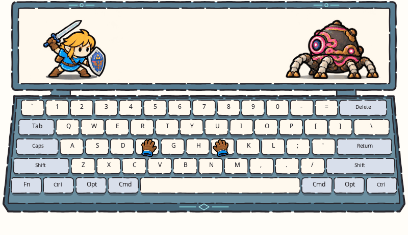

# 塞尔达



Miucs API v1 独立皮肤，按确认的第二版概念图制作。保留现有 800×460 画布、上方显示区和五行 ANSI 键盘。石蓝色边框、奶油白键帽、希卡青蓝纹路；真实键位和文字由运行时绘制。

## 动作

- 左半区新按键：林克播放 8 帧挥剑（蓄力、出剑、剑光、收剑）。右半区新按键：播放 8 帧举盾／盾反（抬盾、格挡、接触、回弹）。空格交替，两侧同时按下优先举盾。长按重复不重触发；密集输入只保留一个 180ms 内的近期动作，停输后不会排队补播。
- 左右手套各 4 帧，跟随各自分区最后按下的键，支持多键高亮、修饰键、Caps Lock、按下及松开。保留原键位映射，普通键压下发青光。
- 守护者 16 帧蓄能／发射／后坐／复位。每个可靠拍点立即发出一束约 130ms 的激光，命中当前盾牌位置。根据最近拍点的 BPM 预演一次蓄能，预测时刻没有收到真实拍点就不发射、不重复循环。
- 静音和音频断开立即撤掉激光；键盘与音频会话、序号和恢复互不影响。过期输入、队列丢失、系统重复、长时间卡顿及隐藏恢复不补播。守护者不根据音量假造拍点。

## 逐帧资源

内置 imagegen 生成 40 个绘制帧：林克 16、守护者 16、手套 8。角色关节、身体重心、剑光、蓄能光和后坐都画在图集中。运行时只选帧；角色的地面锚点和像素缩放恒定。`frames.lua` 的裁切位移用于消除模型排版间距差异，不生成动作轨迹。激光直线和碰撞小星芒由 Skia 绘制，随帧中的眼睛和盾牌接触点对齐。

生成图像保留少量手绘帧间线条差异。原始 PNG 未重绘或重新采样；每个图集的来源与提示词见 [ASSETS.md](ASSETS.md)。

## 安装

将整个 `zelda-guardian` 文件夹复制到用户插件目录，确保 `manifest.json` 在第一层：

- macOS：`~/Library/Application Support/Miucs/Plugins/zelda-guardian/`
- Windows：`%LOCALAPPDATA%\Miucs\Plugins\zelda-guardian\`

应用菜单选择「重新扫描插件」，再在「可视化」中选择「塞尔达」。源码构建会自动打包所有 `plugins/` 子目录；已内置相同 ID 时不要再安装用户副本，以免重名。

## 验证与预览

```sh
python3 tools/plugins/register_zelda_frames.py
python3 tools/plugins/validate.py plugins/zelda-guardian
python3 tests/plugins/zelda_replay.py
python3 tools/plugins/zelda_preview.py
sh scripts/test-plugins.sh
```

`docs/concepts/zelda-guardian/runtime-preview.webp` 为正式 Lua worker 与 Skia 渲染器输出的 9 秒透明动画，依次包含静止、仅键盘、仅音乐、两者同时输入及停止。GIF 为便于观看使用浅色背景。输入是合成数据，不是桌面录屏；系统权限、真实音频识别和 Windows 实机效果不包含在此回放验证内。
